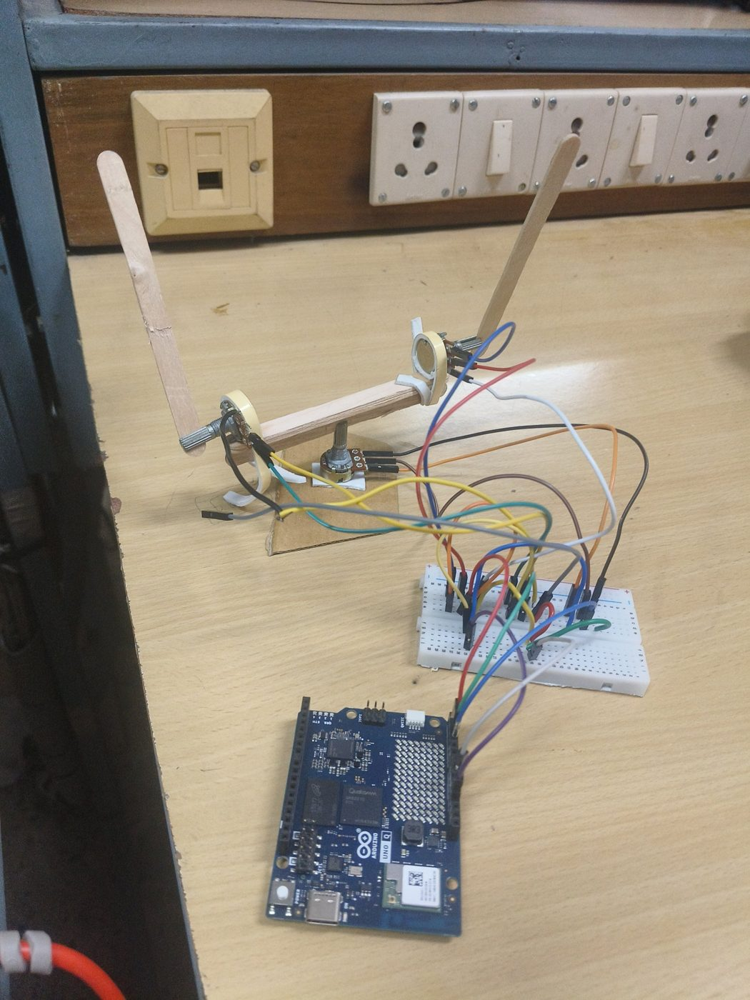
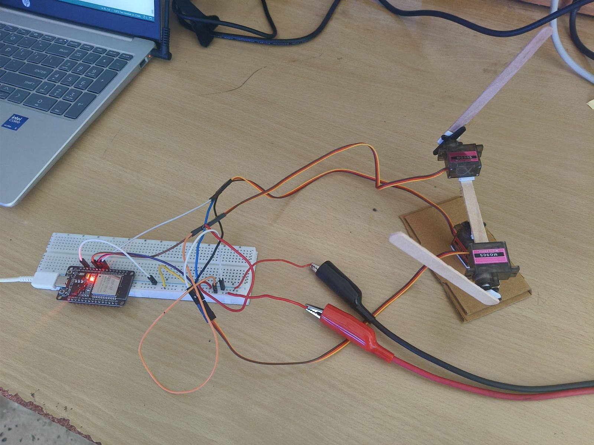
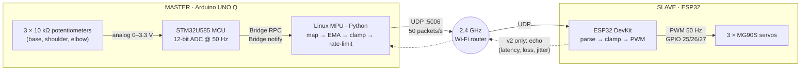
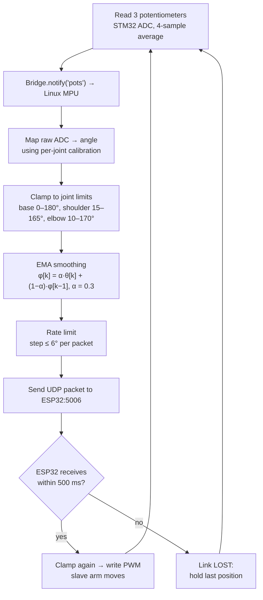
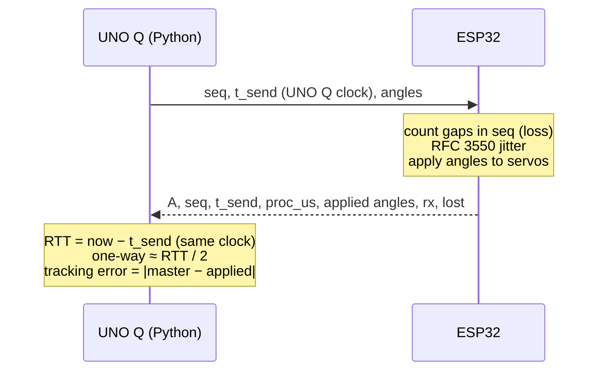
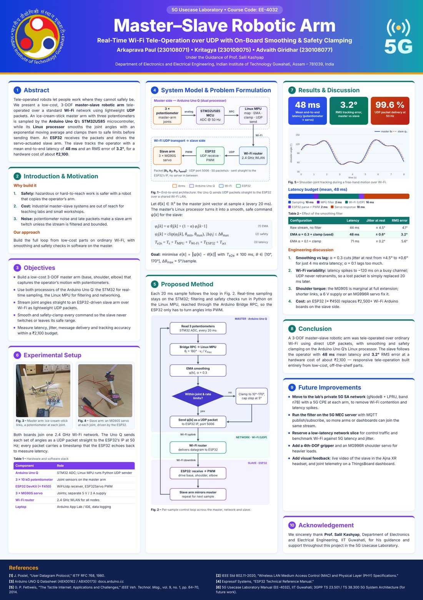

# Master–Slave Robotic Arm

**Real-time Wi-Fi tele-operation over UDP, with on-board smoothing and safety clamping**

*5G Usecase Laboratory (EE-4032) · Department of Electronics and Electrical Engineering · IIT Guwahati*

A low-cost, 3-DOF master–slave robotic arm. You move a hand-held **master arm** fitted with potentiometers, and a servo-driven **slave arm** copies the motion in real time over ordinary Wi-Fi. The master side runs on an **Arduino UNO Q** (STM32 microcontroller + Linux processor) and the slave side runs on an **ESP32**. The whole build costs about **₹2,100**.

<p align="center">
  
  &nbsp;&nbsp;
  
</p>
<p align="center"><i>Left: master arm (potentiometers + Arduino UNO Q). Right: slave arm (MG90S servos + ESP32).</i></p>

---

## Contents

1. [Highlights](#highlights)
2. [How it works](#how-it-works)
3. [Repository layout](#repository-layout)
4. [Hardware](#hardware)
5. [Wiring](#wiring)
6. [Getting started](#getting-started)
7. [v1 vs v2: control and measurement builds](#v1-vs-v2-control-and-measurement-builds)
8. [Results and poster](#results-and-poster)
9. [Tuning](#tuning)
10. [Troubleshooting](#troubleshooting)
11. [Future work](#future-work)
12. [Team and acknowledgement](#team-and-acknowledgement)
13. [References](#references)

---

## Highlights

- **3 degrees of freedom:** base swivel, shoulder and elbow.
- **Dual-processor master:** the UNO Q's STM32 samples the potentiometers at 50 Hz; its Linux processor filters the angles and sends them over Wi-Fi.
- **Direct UDP link:** no broker or server in between. Each sample goes straight from the UNO Q to the ESP32's IP address.
- **Safety in two places:** the master clamps every joint to its mechanical limits and caps how far a joint can move per packet; the ESP32 clamps again before driving the servos, and holds position if the link drops.
- **Smoothing:** an exponential moving average (EMA) removes potentiometer jitter.
- **Built-in measurement (v2):** every packet is echoed back, so the master measures latency, jitter, packet delivery, tracking error, data rate and the filter's noise/lag trade-off on its own clock, with no clock sync needed.

---

## How it works

### System architecture



### Per-sample control loop (every 20 ms)



### Signal processing on the master

For each joint *i* at sample *k*:

| Step | Equation | Purpose |
|---|---|---|
| Calibration | θᵢ[k] = map(ADCᵢ[k], calibration) | turn a raw 0–4095 reading into degrees |
| Smoothing | φᵢ[k] = α θᵢ[k] + (1 − α) φᵢ[k−1] | low-pass filter against pot noise |
| Safety | ψᵢ[k] = clip(φᵢ[k], θmin, θmax), \|Δψᵢ\| ≤ Δθmax | keep the slave inside its safe range and stop sudden jumps |

The EMA trades smoothness for lag: at 50 Hz it delays a moving joint by about (1 − α)/α samples, roughly **45 ms at α = 0.3**. The v2 build measures this directly.

### Packet formats

| Build | Direction | Format (plain text) | Example |
|---|---|---|---|
| v1 | UNO Q → ESP32 | `base,shoulder,elbow` | `92,45,130` |
| v2 | UNO Q → ESP32 | `seq,t_us,base,shoulder,elbow` | `1532,48211093,92,45,130` |
| v2 | ESP32 → UNO Q | `A,seq,t_us,proc_us,base,shoulder,elbow,rx,lost` | `A,1532,48211093,41,92,45,130,1530,2` |

The v2 ESP32 also accepts the v1 format, so a v1 master still drives a v2 slave (without the statistics).

### How latency is measured (v2)



---

## Repository layout

```
5G-Master-Slave-Robotic-Arm/
├── README.md                         ← you are here
├── LICENSE
├── master_uno_q/                     ← Arduino UNO Q app (paste into Arduino App Lab)
│   ├── v1_control/                   ← original control code
│   │   ├── sketch/sketch.ino         (STM32: read pots, Bridge.notify)
│   │   └── python/main.py            (Linux: calibrate, smooth, clamp, UDP send)
│   └── v2_measurement/               ← same control loop + full measurement report
│       ├── sketch/sketch.ino         (+ ADC timing, Bridge "ping")
│       └── python/main.py            (+ RTT, jitter, delivery, tracking, filter table, CSV log)
├── slave_esp32/                      ← open these in Arduino IDE
│   ├── v1_control/esp32_slave/esp32_slave.ino
│   └── v2_measurement/esp32_slave_measure/esp32_slave_measure.ino   (+ echo, loss, jitter)
├── tests/
│   ├── esp32_hello_world/            ← check board, cable and COM port
│   └── esp32_servo_test/             ← check servo wiring and power, no Wi-Fi
├── docs/
│   ├── WIRING.md                     ← pin-by-pin wiring and power rules
│   ├── MEASUREMENTS.md               ← how to read the v2 report and fill the poster tables
│   ├── TROUBLESHOOTING.md            ← problems we hit and how we fixed them
│   └── images/                       ← photos and poster preview
└── poster/
    └── Master_Slave_Robotic_Arm_Poster_A1.pdf
```

---

## Hardware

| Component | Qty | Role | Approx. cost |
|---|---|---|---|
| Arduino UNO Q | 1 | Master controller: STM32U585 reads the pots, Linux MPU filters and sends | (lab board) |
| 10 kΩ rotary potentiometer + knob | 3 | Joint sensors on the master arm | ₹90 |
| ESP32 DevKit (CP2102 USB) | 1 | Slave controller: UDP receiver and servo PWM | ₹450 |
| MG90S metal-gear micro servo | 3 | Slave joints | ₹750 |
| 5 V, ≥ 2.5 A supply (bench supply or adapter) | 1 | Servo power, kept separate from the ESP32 | — |
| Breadboards, jumper wires, crocodile clips | — | Wiring | ₹200 |
| Ice-cream sticks, cardboard, tape | — | Arm links and base | ₹50 |
| 2.4 GHz Wi-Fi router or hotspot | 1 | Shared network for both boards | — |

**Software:** Arduino App Lab (UNO Q), Arduino IDE 2.x with the *esp32* board package and the **ESP32Servo** library (ESP32).

---

## Wiring

Full details and power rules are in [docs/WIRING.md](docs/WIRING.md).

| Joint | Master: pot wiper → UNO Q | Slave: servo signal → ESP32 |
|---|---|---|
| Base | A2 | GPIO 25 |
| Shoulder | A3 | GPIO 26 |
| Elbow | A4 | GPIO 27 |

```
MASTER (UNO Q)                         SLAVE (ESP32, powered over USB)
pot outer leg  → 3V3                   servo red    → supply (+) 5 V
pot outer leg  → GND                   servo brown  → supply (–) ──┐
pot wiper      → A2 / A3 / A4          servo orange → GPIO 25/26/27│
                                       ESP32 GND ──────────────────┘   (shared ground)
```

> [!WARNING]
> Power the potentiometers from **3V3**, not 5 V (A0/A1 are not 5 V tolerant, and the ADC reads only 0–3.3 V).
> Never power the servos from the ESP32's pins. The **only** wire between the servo supply and the ESP32 is GND; servo current or supply voltage reaching the ESP32's 3V3/VIN pins can destroy the board.

---

## Getting started

Bring up the **slave first**, then the master.

### 1. Slave (ESP32, Arduino IDE)

1. Install the **esp32** board package (Boards Manager) and the **ESP32Servo** library (Library Manager).
2. Select **Tools → Board → ESP32 Dev Module** and the ESP32's COM port.
3. *(Optional)* Upload `tests/esp32_hello_world` to check the board, then `tests/esp32_servo_test` with the servo horns off to check wiring and power.
4. Open `slave_esp32/v1_control/esp32_slave/esp32_slave.ino` (or the v2 sketch), set `WIFI_SSID` and `WIFI_PASS` to your 2.4 GHz network, and upload.
5. Open the Serial Monitor at **115200 baud** and press **EN**. Note the line `ESP32 IP: 192.168.x.x`.
6. Switch on the servo supply. The servos move to 90° and the monitor prints `link=down` until the master starts.

### 2. Master (UNO Q, Arduino App Lab)

1. Connect the UNO Q to the **same Wi-Fi network** as the ESP32.
2. In App Lab, create a new app (e.g. `master_arm`).
3. Paste `master_uno_q/v1_control/sketch/sketch.ino` (or v2) into the app's `sketch/sketch.ino`, and `python/main.py` into the app's `python/main.py`. If `Arduino_RouterBridge.h` is not found, add the **Arduino_RouterBridge** library from the sketch's library panel.
4. In `main.py`, set `ESP32_IP` to the address from step 1.5.

### 3. Calibrate (first time only)

1. Set `CALIBRATE = True` in `main.py` and press **Run**. The console prints `RAW base=… shoulder=… elbow=…` (0–4095).
2. Move each master joint to one end of its travel and note the value, then the other end.
3. Enter the numbers in the `CAL` table: `(raw at end A, raw at end B, angle at end A, angle at end B)`. If a joint moves the wrong way later, swap the two angles.

### 4. Run

1. Set `CALIBRATE = False` and press **Run**.
2. The ESP32 monitor shows `Link UP` and about 50 packets/s; the slave follows the master.
3. With the link running and the master in a neutral pose, fit the slave's servo horns so the two arms match.

---

## v1 vs v2: control and measurement builds

| | **v1_control** | **v2_measurement** |
|---|---|---|
| Purpose | Day-to-day tele-operation | Collect the numbers for the report and poster |
| Packet | `base,shoulder,elbow` | `seq,t_us,base,shoulder,elbow` + echo |
| Send timing | `sleep(20 ms)` per loop | deadline-based, steady 50 Hz |
| UNO Q prints | raw → sent angles | a full report every 5 s, plus `arm_log.csv` |
| ESP32 prints | packets/s, angles, link | + data rate, loss, reordering, max gap, RFC 3550 jitter, processing time, RSSI, 10 s totals |

**Upload both sides from the same version.** The v2 master needs the v2 ESP32 sketch to get echoes; without them it still controls the arm but reports `echoed 0`.

The v2 report covers:

- **Latency:** RTT mean / median / p95 / p99 / max, one-way ≈ RTT/2.
- **Jitter:** RTT standard deviation, mean |ΔRTT|, spikes over 100 ms; the ESP32 adds RFC 3550 inter-arrival jitter.
- **Delivery:** round-trip and UNO Q → ESP32 packet delivery.
- **Latency budget:** ADC, Bridge, wait for the send tick, Python, Wi-Fi and ESP32 time, summed to *pot → servo command*.
- **Data rate:** payload and on-air (with UDP/IP headers) kbit/s in each direction.
- **Tracking error:** |master angle − angle the ESP32 applied| per joint (mean / RMS / max).
- **Filter comparison:** noise at rest and lag for raw, α = 0.3 and α = 0.1, side by side from the same samples.

How to run a measurement session and map the output to the poster: [docs/MEASUREMENTS.md](docs/MEASUREMENTS.md).

---

## Results and poster

<p align="center">
  <a href="poster/Master_Slave_Robotic_Arm_Poster_A1.pdf"></a>
</p>
<p align="center"><i>A1 poster: <a href="poster/Master_Slave_Robotic_Arm_Poster_A1.pdf">poster/Master_Slave_Robotic_Arm_Poster_A1.pdf</a></i></p>

Figures reported on the poster:

| Metric | Value |
|---|---|
| Mean end-to-end latency (potentiometer → servo) | 48 ms |
| RMS tracking error, master vs slave | 3.2° |
| UDP packet delivery at 50 Hz | 99.6 % |
| Hardware cost | ≈ ₹2,100 |

| Configuration | Latency | Jitter at rest | RMS error |
|---|---|---|---|
| Raw stream, no filter | 44 ms | ± 4.5° | 4.1° |
| EMA α = 0.3 + clamp (used) | 48 ms | ± 0.6° | 3.2° |
| EMA α = 0.1 + clamp | 71 ms | ± 0.2° | 5.6° |

> [!NOTE]
> These are the figures printed on the poster. Re-run the **v2_measurement** build on your own hardware and network to reproduce them; Wi-Fi conditions change latency and loss a lot. [docs/MEASUREMENTS.md](docs/MEASUREMENTS.md) explains which report line gives each number.

**Engineering takeaways**

1. **Smoothing vs lag:** a smaller α gives a steadier slave at rest but a slower response; α = 0.3 is the compromise used.
2. **Wi-Fi variability:** a busy 2.4 GHz channel causes occasional latency spikes. UDP never retransmits, so a lost packet is simply replaced 20 ms later.
3. **Shoulder torque:** the MG90S is marginal at full extension; shorter links, a 6 V supply or an MG996R fixes it.
4. **Power isolation:** servos need their own supply with only GND shared, or the ESP32 browns out or is damaged.

---

## Tuning

All in `main.py` (keep `LIMITS` the same in the ESP32 sketch):

| Setting | Default | Effect |
|---|---|---|
| `SEND_HZ` | 50 | packets per second |
| `ALPHA` | 0.3 | EMA weight: lower is smoother but laggier (0.2–0.5 is sensible) |
| `MAX_STEP` | 6 | max degrees a joint may move per packet (6° × 50 Hz = 300°/s) |
| `LIMITS` | base 0–180, shoulder 15–165, elbow 10–170 | mechanical safety range of the slave |
| `REPORT_EVERY_S` (v2) | 5 | how often the measurement report prints |
| `SPIKE_MS` (v2) | 100 | RTT above this counts as a spike |
| `COMPARE_ALPHAS` (v2) | (1.0, 0.3, 0.1) | filters compared side by side |

---

## Troubleshooting

Quick checks below; the full list is in [docs/TROUBLESHOOTING.md](docs/TROUBLESHOOTING.md).

| Symptom | Likely cause | Fix |
|---|---|---|
| ESP32 shows `link=down` forever | wrong `ESP32_IP`, or boards on different networks | re-read the IP after pressing EN; same 2.4 GHz network; no client isolation |
| UNO Q prints `waiting for pot data…` | sketch didn't compile or upload | check the App Lab sketch output |
| ESP32 stuck on `Connecting....` | 5 GHz/WPA3 network, wrong password | use 2.4 GHz WPA2; read the printed disconnect reason |
| Upload fails: *Failed to connect to ESP32* | board not in download mode, port busy | hold **BOOT** while `Connecting…`, close Serial Monitor, try 115200 upload speed |
| Servos twitch, ESP32 resets | shared power or missing common ground | separate 5 V supply, join grounds, 470–1000 µF across servo rails |
| A joint moves the wrong way | calibration direction | swap the two angles on that joint's `CAL` line |

---

## Future work

- Move to the lab's **private 5G SA network** (gNodeB + LPRU, band n78) with a 5G CPE at each arm, to remove Wi-Fi contention and latency spikes.
- Run the filter on the **5G MEC server** with MQTT publish/subscribe, so more arms or dashboards can join the same stream.
- Reserve a **low-latency network slice** for control traffic and benchmark Wi-Fi against 5G.
- Add a 4th-DOF gripper and an MG996R shoulder servo for heavier loads.
- Add visual feedback: live video of the slave in the Ajna XR headset, and joint telemetry on a ThingsBoard dashboard.

---

## Team and acknowledgement

- **Arkaprava Paul** (230108071)
- **Kritagya** (230108075)
- **Advaith Giridhar** (230108077)

Department of Electronics and Electrical Engineering, Indian Institute of Technology Guwahati.

We sincerely thank **Prof. Salil Kashyap**, Department of Electronics and Electrical Engineering, IIT Guwahati, for his guidance and support throughout this project in the 5G Usecase Laboratory.

---

## References

1. J. Postel, "User Datagram Protocol," IETF RFC 768, 1980.
2. IEEE Std 802.11-2020, "Wireless LAN Medium Access Control (MAC) and Physical Layer (PHY) Specifications."
3. Arduino UNO Q Datasheet (ABX00162 / ABX00173), docs.arduino.cc.
4. Espressif Systems, "ESP32 Technical Reference Manual."
5. G. P. Fettweis, "The Tactile Internet: Applications and Challenges," *IEEE Veh. Technol. Mag.*, vol. 9, no. 1, pp. 64–70, 2014.
6. H. Schulzrinne et al., "RTP: A Transport Protocol for Real-Time Applications," IETF RFC 3550, 2003 (inter-arrival jitter estimator).
7. 5G Usecase Laboratory Manual (EE-4032), IIT Guwahati; 3GPP TS 23.501 / TS 38.300 (5G system architecture, for future work).

---

## License

Released under the [MIT License](LICENSE).
