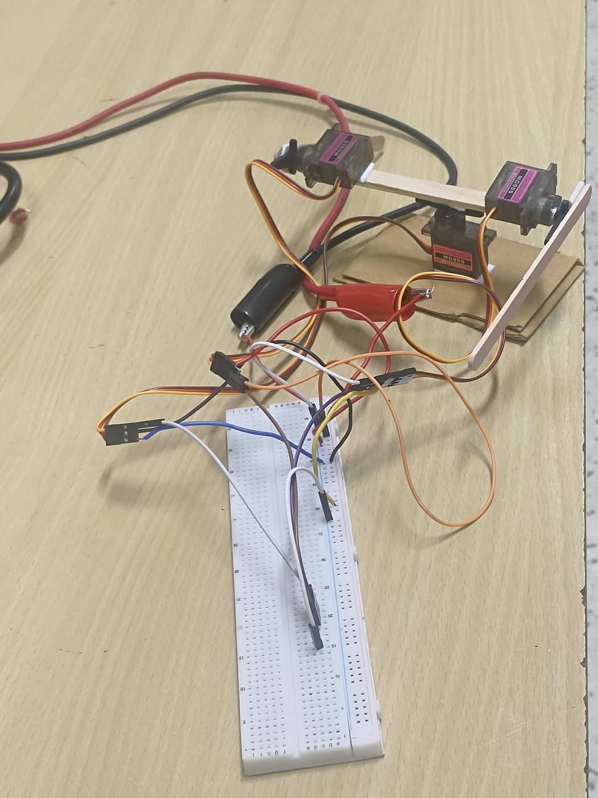

# Wiring

[← Back to README](../README.md)

## Master side: Arduino UNO Q + 3 potentiometers

Each potentiometer has three legs. The two outer legs set the voltage range and the middle leg (the *wiper*) gives a voltage that changes as the knob turns.

| Pot leg | Connect to |
|---|---|
| Outer leg 1 | UNO Q **3V3** |
| Outer leg 2 | UNO Q **GND** |
| Wiper (middle) | **A2** (base), **A3** (shoulder), **A4** (elbow) |

- Use **3V3, not 5V.** The ADC only reads 0–3.3 V; anything higher just reads as the maximum and you lose part of the knob's travel. A0 and A1 are not 5 V tolerant at all, which is why the build uses A2–A4.
- Three 10 kΩ pots draw about 1 mA in total, so the UNO Q powers them easily.
- Optional: a 100 nF capacitor from each wiper to GND reduces noise further.

**Mounting:** fix the pot's body to one link with its threaded bushing and nut, and lock its shaft to the next link with a knob, so the shaft turns exactly with the joint.

## Slave side: ESP32 + 3 MG90S servos

<p align="center"></p>

| Servo wire | Connect to |
|---|---|
| Brown / black (ground) | Servo supply **(–)**, and a wire from there to an ESP32 **GND** pin |
| Red (power) | Servo supply **(+)**, 5–6 V |
| Orange / yellow (signal) | ESP32 **GPIO 25** (base), **GPIO 26** (shoulder), **GPIO 27** (elbow) |

```
 Servo supply 5 V (+) ─────┬──────────┬──────────┐
                          red        red        red
                        [base]   [shoulder]  [elbow]
                         brown      brown      brown
 Servo supply (–) ─────────┴──────────┴──────────┴────── ESP32 GND
                        orange     orange     orange
                          │          │          │
                       GPIO25     GPIO26     GPIO27
 ESP32 powered from the laptop over USB
```

## Power rules

1. **Servos get their own supply.** Three MG90S can draw over 1 A while moving and much more if one stalls. From the ESP32's 5V pin that current would come through the laptop's USB port: the voltage dips, the ESP32 resets ("Brownout detector was triggered") and Wi-Fi drops.
   - Bench supply at **5.0–6.0 V with a ~2.5 A current limit** (the ammeter is handy for the report), or a 5 V 2–3 A adapter, or 4 × AA NiMH (4.8 V). Fresh alkaline cells start near 6.4 V, slightly above the MG90S's 6 V maximum.
2. **Share ground only.** The supply's (–) must connect to ESP32 GND, or the servos twitch at random. The supply's (+) must **never** touch any ESP32 pin.
3. **Add a 470–1000 µF capacitor** across the servo power rails on the breadboard to absorb current spikes.
4. **Avoid boot-strapping pins.** Keep signal wires off GPIO 0, 2, 12 and 15; something pulling on them can stop the ESP32 from booting or accepting an upload.

> [!CAUTION]
> During this project one ESP32 stopped responding entirely: its USB chip still showed a COM port, but the ESP32 never printed anything, even when reset in download mode. This is what happens when the servo supply reaches the 3V3/VIN pins or a short occurs. Check with a multimeter: 3V3 to GND should read 3.3 V with only USB connected.

## Bring-up order

1. `tests/esp32_hello_world`: board, cable, driver and port work.
2. `tests/esp32_servo_test` with the horns **off**: each servo moves 60° → 120° → 90° in turn and the ESP32 doesn't reset.
3. Slave sketch, then master app (see the README).
