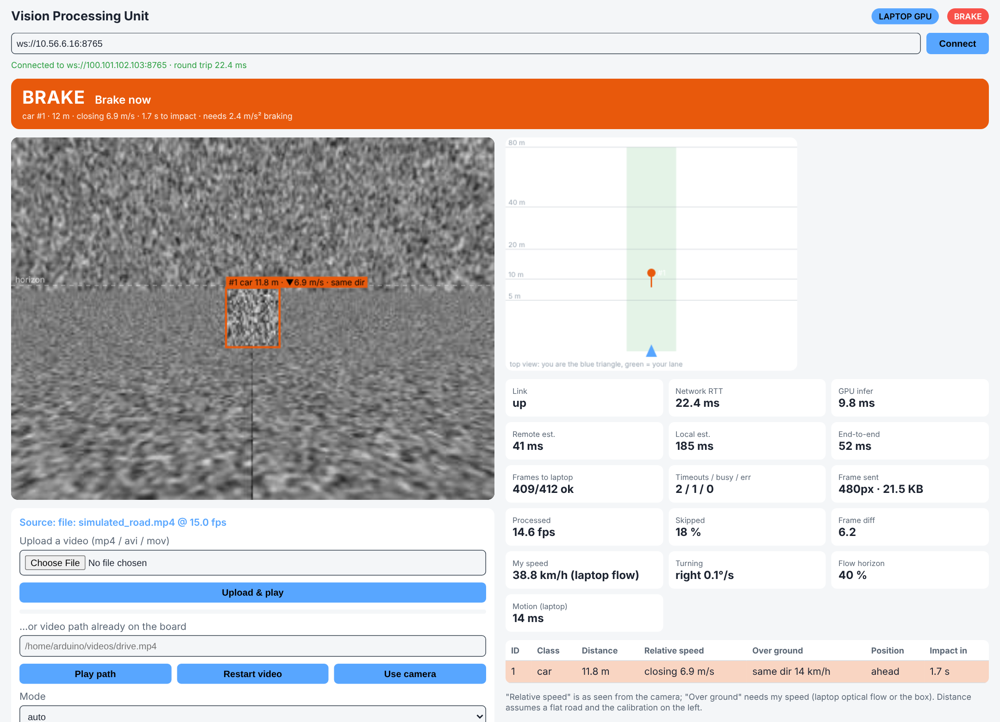
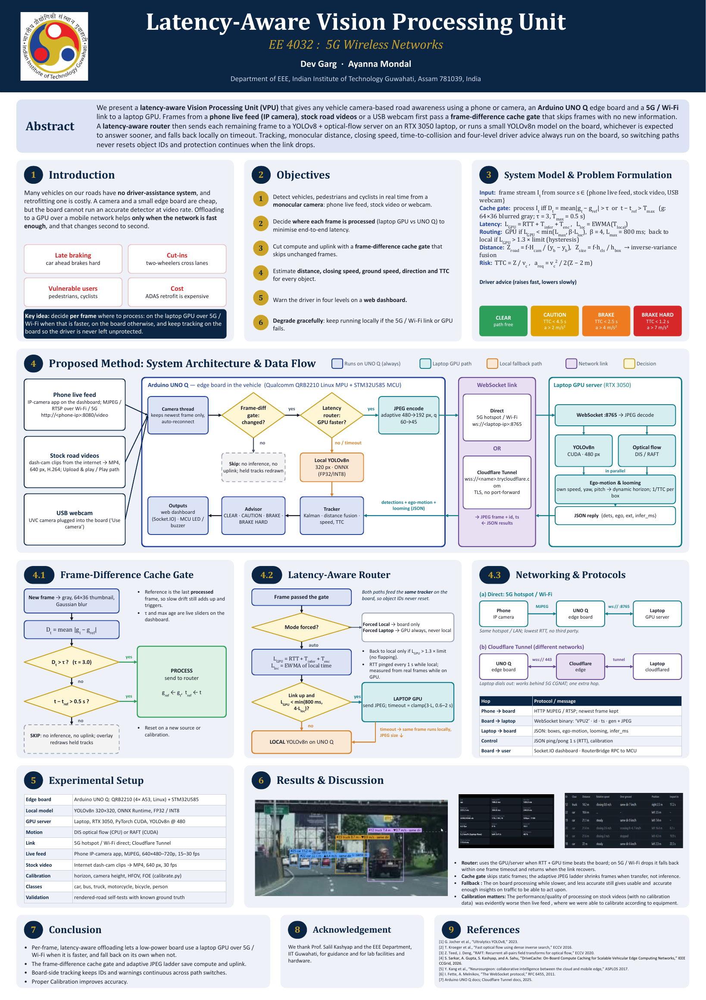
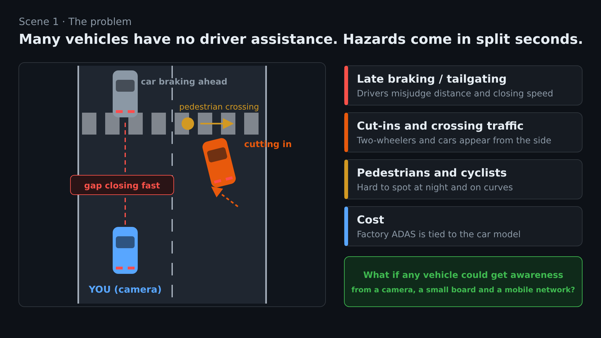
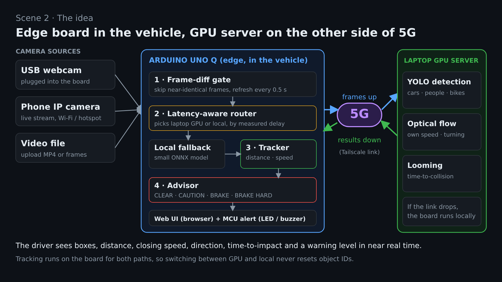
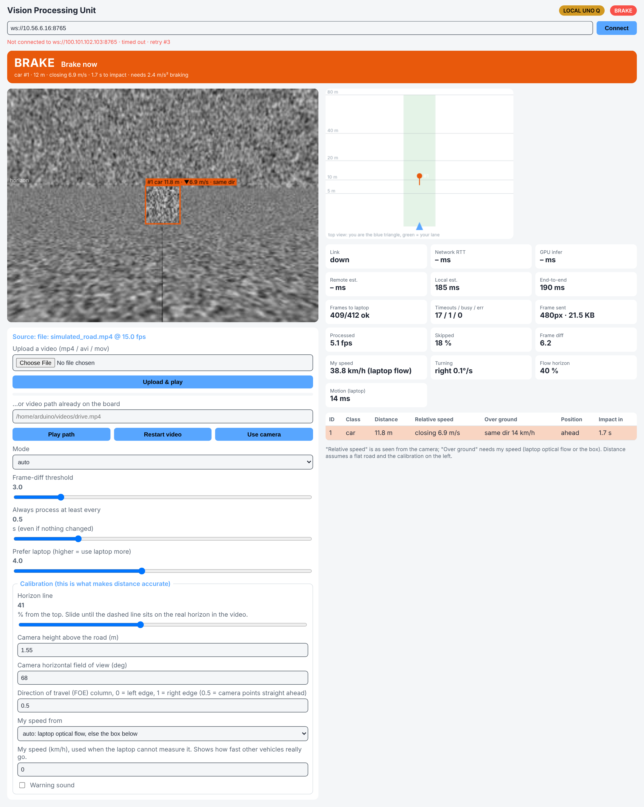
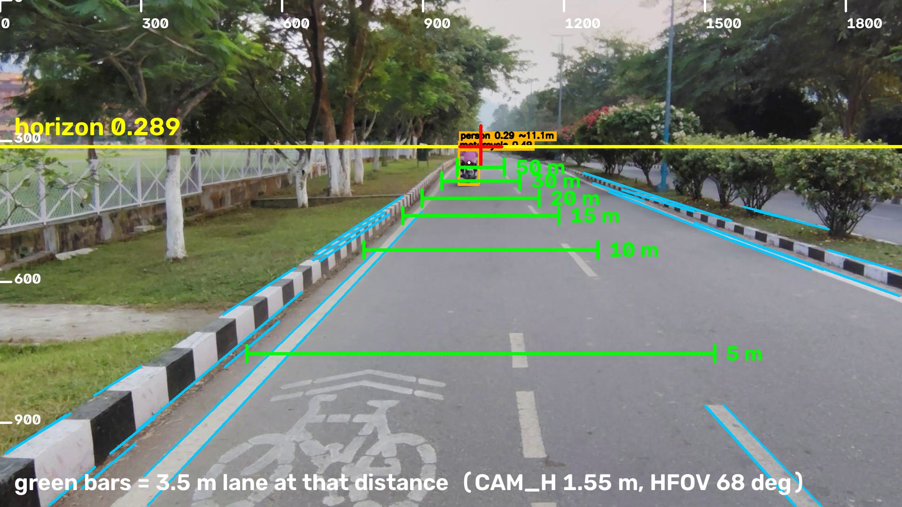

# Latency-aware Vision Processing Unit

Road-scene understanding on a small edge board that borrows a laptop GPU only when the network makes that worthwhile.
An **Arduino UNO Q** (camera, tracking, warnings, web UI) and a **laptop with a GPU** (YOLO + optical-flow
motion analysis) are linked over Wi-Fi / 5G / LAN. A latency-aware router decides, frame by frame, where detection runs,
and falls back to the board itself if the link slows down or drops.


*The board's web UI. Simulated scene, for illustration only (rendered road, see [Verification](#verification-and-limitations)); the UI, tracker, advisor and motion code are the real ones.*

---

## Project deliverables: poster and video

| Deliverable | File | How to view |
|---|---|---|
| **A1 poster** | [`docs/VPU_Poster_A1.pdf`](docs/VPU_Poster_A1.pdf) | Click the preview below, or open the PDF directly. |
| **Demonstration video** | [`docs/5G_proj.mp4`](docs/5G_proj.mp4) | ~200 MB, stored with Git LFS. On GitHub click the file, then **Download** (or *View raw*) if it does not play in the browser. |

[](docs/VPU_Poster_A1.pdf)

> **Getting the video after cloning:** the video is a Git LFS file. Run `git lfs install` *before* `git clone`, or run
> `git lfs pull` afterwards. Without LFS you only get a 134-byte pointer file. To skip the 200 MB download when you
> only want the code: `GIT_LFS_SKIP_SMUDGE=1 git clone <repo-url>`.

---

## Contents
1. [Project deliverables: poster and video](#project-deliverables-poster-and-video)
2. [What it does](#what-it-does)
3. [Architecture](#architecture)
4. [Repository structure](#repository-structure)
5. [Setup](#setup)
6. [Using the web UI](#using-the-web-ui)
7. [How it works](#how-it-works)
8. [Calibration](#calibration)
9. [Test footage and cameras](#test-footage-and-cameras)
10. [Tests](#tests)
11. [Verification and limitations](#verification-and-limitations)
12. [Further documentation](#further-documentation)
13. [Roadmap](#roadmap)
14. [Team and course](#team-course-and-licence)
15. [Acknowledgements](#acknowledgements)

---

## What it does
- **Detects** cars, buses, trucks, motorcycles, bicycles and pedestrians (YOLOv8).
- **Measures** for every object: distance, closing speed, time-to-collision (TTC), lateral position, **direction**
  (same dir / oncoming / crossing L->R / R->L / stopped) and speed over ground.
- **Knows its own motion** from dense optical flow: own speed, turn rate, pitch, dynamic horizon.
- **Warns**: CLEAR / CAUTION / BRAKE / BRAKE HARD banner, optional sound, optional MCU output (LED/buzzer sketch).
- **Adapts to the network**: local vs laptop inference chosen from measured RTT + GPU time; hard timeouts and local fallback.
- **Takes any source**: USB webcam, uploaded video, video path, or a **phone as IP camera** (live).

### Why
A fast-moving vehicle, robot or drone cannot rely on a cloud round trip being fast *every time*. Doing everything on the
edge board is slow; sending everything to a GPU is fragile. This project measures the link continuously and picks the
cheaper path per frame, while tracking and safety logic always stay on the board.



## Architecture


```
Camera -> frame-diff gate -> router -+-> local ONNX detector (UNO Q CPU) ------+
                                     |                                         +-> tracker -> advisor -> web UI / MCU
                                     +-> laptop GPU over WebSocket (YOLO+flow) +      (always on the UNO Q)
```

Details: [docs/how-it-works.md](docs/how-it-works.md), wire protocol: [docs/protocol.md](docs/protocol.md).

---

## Repository structure

```text
vision-processing-unit/
├── README.md                     This file
├── .gitignore                    Ignores weights (*.pt, *.onnx), videos, calib_out/, uploads/, .venv/
├── .gitattributes                Tracks *.mp4 with Git LFS
│
├── laptop/                       GPU SIDE: runs on the laptop
│   ├── server.py                 WebSocket server (port 8765): YOLOv8 detector + motion analysis per connected board
│   ├── motion.py                 Optical flow (DIS / RAFT), ego-motion fit, looming (1/TTC), optional metric depth
│   ├── selftest_motion.py        Test: ego speed / TTC / horizon on a rendered road with known ground truth
│   ├── selftest_tracking.py      Test: car ahead / stopped / oncoming through motion + tracker
│   └── requirements.txt          Laptop Python dependencies
│
├── unoq_app/                     BOARD SIDE: the Arduino App Lab app (copy into an App Lab project)
│   ├── app.yaml                  App Lab manifest (declares the Web UI brick)
│   ├── python/
│   │   ├── main.py               Pipeline: gate -> router -> detector -> tracker -> advisor -> UI/MCU; config + env vars
│   │   ├── camera.py             USB camera / video file / IP-camera stream; keeps only the newest frame
│   │   ├── remote.py             WebSocket client: RTT pings, timeouts, reconnect, protocol v1/v2
│   │   ├── detectors.py          Local YOLOv8n ONNX (320x320) fallback detector (onnxruntime or cv2.dnn)
│   │   ├── tracking.py           Tracker: depth fusion, per-track Kalman filters, direction labels
│   │   ├── advisor.py            CLEAR / CAUTION / BRAKE / BRAKE HARD logic from TTC and required deceleration
│   │   ├── requirements.txt      Intentionally empty (opencv/numpy/websockets ship with the UNO Q image)
│   │   └── models/               (you create this) put yolov8n_320.onnx here; not in git
│   ├── assets/                   Web UI served by the board
│   │   ├── index.html
│   │   ├── app.js
│   │   ├── style.css
│   │   └── libs/socket.io.min.js
│   └── sketch/
│       └── sketch.ino            MCU side (STM32U585): blinks the LED by alert level via the Router Bridge
│
├── tools/                        LAPTOP-SIDE HELPERS (not needed on the board)
│   ├── export_onnx.py            YOLOv8n -> yolov8n_320.onnx for the board's local fallback
│   ├── quantize_int8.py          Optional INT8 version of the local model (yolov8n_320_int8.onnx)
│   ├── check_link.py             Run on the board: tests TCP reachability and latency to the laptop
│   ├── calibrate.py              Estimate HORIZON / CAM_H / HFOV from a video; writes an overlay + calibration.json
│   ├── replay.py                 Offline run on a video: annotated MP4 + CSV, no board needed
│   ├── frames_to_video.py        Turn a folder of frames (e.g. DriveCache) into an MP4
│   └── make_screenshots.py       Regenerates docs/images/ui_*.png from the real UI + simulated scene
│
└── docs/
    ├── VPU_Poster_A1.pdf         Project poster (deliverable)
    ├── 5G_proj.mp4               Project video (deliverable, Git LFS)
    ├── setup.md                  Short setup notes (full version is in this README)
    ├── how-it-works.md           Pipeline, router and motion analysis in detail
    ├── calibration.md            Calibration settings and how to measure them
    ├── datasets-and-cameras.md   Test footage (DriveCache) and phone IP-camera setup
    ├── protocol.md               Board <-> laptop WebSocket protocol
    └── images/                   Figures used in the docs (architecture, UI screenshots, poster preview ...)
```

Files created at run time (all git-ignored): `unoq_app/python/uploads/` (videos uploaded in the web UI),
`unoq_app/python/remote_url.txt` (last laptop address typed in the UI), `calib_out/`, `*_tracks.csv`, `*.onnx`, `*.pt`.

---

## Setup

### 1. What you need

| Part | Requirement |
|---|---|
| **Edge board** | Arduino UNO Q (Qualcomm QRB2210 Linux MPU + STM32U585 MCU), with [Arduino App Lab](https://www.arduino.cc/pro/software-pro-app-lab/) installed on your computer |
| **Laptop** | NVIDIA GPU with CUDA recommended (developed on an RTX 3050 laptop). The server auto-selects CUDA, then OpenVINO (Intel GPU/CPU), then plain CPU, so it still runs without an NVIDIA GPU, just slower. |
| **Camera** (any one) | USB webcam on the board; a video file; or a phone running an IP-camera app |
| **Network** | Board and laptop must reach each other on TCP port **8765**: same router / hotspot / Ethernet switch, or a VPN such as Tailscale or ZeroTier |
| **Software** | Python 3.10+ on the laptop (recommended), Git, and Git LFS if you want the video |

### 2. Get the code
```bash
git lfs install                       # once per machine (needed for docs/5G_proj.mp4)
git clone https://github.com/ayanna-m246/vision-processing-unit.git
cd vision-processing-unit
```

### 3. Connect the laptop and the board
Pick **one** option. The app only needs the laptop's IP address and port 8765; nothing else in the runtime needs the internet.

**Option A: same network, no internet needed (simplest, lowest latency).** Put both devices on one router, phone hotspot or Ethernet switch.
1. On the laptop find its address: `ipconfig` (Windows) or `ip a` (Linux), e.g. `192.168.1.20`.
2. Allow inbound **TCP 8765** in the laptop firewall.
3. The laptop address for the app is then `ws://192.168.1.20:8765`.

**Option B: different networks, via Tailscale.**
1. Laptop (Windows/Linux): install Tailscale, sign in, then `tailscale ip -4` gives a `100.x.y.z` address.
2. UNO Q (over SSH or `adb shell`): `curl -fsSL https://tailscale.com/install.sh | sh && sudo tailscale up` (same account).
3. Check with `tailscale ping <laptop-name>`: "via `<ip>:port`" means a direct path (fast); "via DERP" means relayed (slower; the app will notice and use local inference more).
4. Allow TCP 8765 on the laptop firewall (Tailscale interface).
5. Laptop address for the app: `ws://100.x.y.z:8765`.

**Option C: Cloudflare quick tunnel** (board behind CGNAT, nothing to open on the laptop; see poster section 4.3). Run `cloudflared tunnel --url http://localhost:8765` on the laptop and use the printed `wss://<name>.trycloudflare.com` address. Expect higher latency than A or B.

> ZeroTier works the same way as Tailscale. The default address in `main.py` is a ZeroTier example (`ws://10.56.6.16:8765`);
> override it with the `LAPTOP_URL` environment variable or by typing your address into the web UI (it is remembered).

### 4. Laptop: start the GPU server
```bash
cd laptop
python -m venv .venv
# Windows: .venv\Scripts\activate        Linux/macOS: source .venv/bin/activate

# Install a CUDA build of PyTorch first (pick your CUDA version at https://pytorch.org/get-started/locally/)
pip install torch torchvision --index-url https://download.pytorch.org/whl/cu121
pip install -r requirements.txt

python server.py
```
`yolov8n.pt` is downloaded automatically on first run (needs internet once; afterwards everything works offline).
Leave the server running. It prints which backend it picked (cuda / openvino / cpu).

Common server options:

| Command | Effect |
|---|---|
| `python server.py --model yolov8s.pt` | Larger model, more accurate, slower |
| `python server.py --flow raft` | Optical flow on the GPU (torchvision RAFT) instead of CPU DIS |
| `python server.py --flow dis-fast` | Cheaper CPU flow for slow laptops |
| `python server.py --motion off` | Detector only (no ego-motion / looming) |
| `python server.py --token SECRET` | Require clients to connect with `?token=SECRET` |
| `python server.py --port 9000 --imgsz 640 --conf 0.4` | Change port, input size, confidence threshold |
| `python server.py --backend cpu` | Force a backend (`auto`, `cuda`, `openvino`, `cpu`) |
| `python server.py --depth` | Experimental Depth Anything V2 depth (needs `pip install transformers`) |

### 5. Laptop: export the local fallback model for the board
The board needs a small ONNX model to keep working when the link is down. With the laptop venv active:
```bash
python ../tools/export_onnx.py          # writes tools/yolov8n_320.onnx (~12 MB)
```
Optional, experimental: `pip install onnx onnxruntime` then `python ../tools/quantize_int8.py path/to/video.mp4`
produces `yolov8n_320_int8.onnx`, which the board prefers if present. If it is not faster or the boxes get worse, delete it
(or set `LOCAL_MODEL=yolov8n_320.onnx`).

### 6. UNO Q: install the app
1. In **Arduino App Lab** create a new app (this generates `sketch.yaml` and the project scaffolding) and add the **Web UI** brick.
2. Copy from this repo's `unoq_app/` into the App Lab project, replacing the generated files:
   `app.yaml`, `python/*`, `sketch/sketch.ino`, `assets/*`.
3. Create `python/models/` in the project and copy `yolov8n_320.onnx` (from step 5) into it.
   Without it the log shows `[local] no ONNX model ... local fallback DISABLED`.
4. Optional: add `onnxruntime` to `python/requirements.txt` for faster local inference (the app falls back to OpenCV's
   built-in ONNX runner otherwise). If App Lab's installer errors, remove the line again. Do **not** list `opencv`/`numpy`/`websockets`; they are preinstalled and listing them breaks the installer.
5. Plug in a USB webcam if you want a live source, then press **Run** in App Lab and open the app's web UI.

### 7. Check the link
In the web UI, type the laptop address (e.g. `ws://192.168.1.20:8765`) in the link box. The badge and link bar show state, RTT and GPU ms.
If it will not connect, run this in the UNO Q terminal (needs no installs; start `server.py` first):
```bash
python3 tools/check_link.py 192.168.1.20 8765
```

### 8. Choose a video source and calibrate
In the web page choose one of:
- **Upload** a video file, or **Play path** with a path already on the board. Paths starting with `http://`, `https://`, `rtsp://` are treated as live streams (this is how a **phone IP camera** is used, e.g. `http://<phone-ip>:8080/video`).
- **Use camera** for a USB webcam.

Then set horizon / camera height / field of view as in [Calibration](#calibration). Without calibration, distances are only roughly right.

### 9. Try it with no hardware at all
The laptop alone can run the full detector + motion + tracker + advisor chain on any video and write an annotated MP4 and a CSV:
```bash
python tools/replay.py clip.mp4 --horizon 0.29 --cam-h 1.55 --hfov 68
python tools/replay.py clip.mp4 --rate 12            # imitate the board: only ~12 frames/s reach the laptop
python tools/replay.py clip.mp4 --detector none      # ego-motion only (no ultralytics needed)
```
And the maths self-tests need neither a GPU nor a video: see [Tests](#tests).

### 10. Configuration reference (board)
Set as environment variables for the app (or change live in the web UI where a control exists):

| Variable | Default | Meaning |
|---|---|---|
| `LAPTOP_URL` | last UI value, else `ws://10.56.6.16:8765` | Laptop WebSocket address |
| `SOURCE` | `none` | `none`, `camera` or `file`, the source started at launch |
| `VIDEO_PATH` | empty | File path or stream URL used when `SOURCE=file` |
| `REMOTE_BIAS` | `4` | Use the laptop unless it is more than this many times slower than local |
| `MAX_REMOTE_MS` | `800` | Never use the laptop if estimated total latency is above this |
| `HFOV_DEG` | `70` | Horizontal field of view of the camera |
| `CAM_H` | `1.3` | Camera height above the road, metres |
| `HORIZON` | `0.45` | Horizon row as a fraction of image height (0 = top) |
| `FOE_X` | `0.5` | Image column the vehicle drives towards (0 = left, 1 = right) |
| `EGO_MODE` | `auto` | `auto` (laptop optical flow, else "my speed" box), `manual`, `off` |
| `USE_MCU` | `0` | `1` sends alert levels to the Arduino sketch |
| `LOCAL_MODEL` | auto | Force a specific ONNX file in `python/models/` |
| `LOCAL_THREADS` | `3` | CPU threads for local inference |

### 11. Troubleshooting

| Symptom | Likely cause and fix |
|---|---|
| Badge stays **LOCAL UNO Q**, link banner shows an error | Server not running, wrong address, or firewall blocking TCP 8765. Run `tools/check_link.py`. |
| Server log: `rejected a client with a missing/wrong token` | Started with `--token`; connect to `ws://<ip>:8765/?token=SECRET`. |
| Board log: `local fallback DISABLED` | No `.onnx` in `python/models/`. Redo step 5 and 6.3. |
| App Lab install fails on opencv / numpy | Keep `python/requirements.txt` as shipped (empty apart from comments). |
| `tailscale ping` says "via DERP" | Traffic is relayed (slow). Try the same-network option, or accept more local inference. |
| Distances look wrong, boxes "above the horizon" | Calibrate (`tools/calibrate.py`); horizon error dominates distance error. |
| Phone stream will not open | Check the URL in a browser first; same Wi-Fi/VPN; the app retries automatically. |
| `docs/5G_proj.mp4` is 134 bytes | Git LFS was not installed when cloning: `git lfs install && git lfs pull`. |

---

## Using the web UI

| | |
|---|---|
|  | Link lost -> badge turns to **LOCAL UNO Q**, link banner shows the error and retry count, tracking continues without resetting IDs. |

Main areas: link bar, advice banner, video with boxes + horizon, top-view radar, live statistics (RTT, GPU ms, frames sent/ok,
timeouts, own speed, turn rate, flow horizon), track table, and controls for source, mode (**auto / local / remote**),
gate threshold, calibration.

**MCU output (optional):** set `USE_MCU=1` and the sketch in `unoq_app/sketch/sketch.ino` blinks the onboard LED:
slow for CAUTION, fast for BRAKE. Replace the blink logic with a real buzzer / brake / CAN output on a vehicle.

---

## How it works

**Pipeline.** The camera thread keeps only the newest frame. A **frame-diff gate** skips frames that barely changed:
a 64x36 blurred grayscale thumbnail is compared with the last *processed* frame and the frame is skipped if the mean
difference is below the threshold (default 3.0), with a forced refresh every 0.5 s. A **router** then picks the detector, and the
**tracker** (always on the UNO Q) and **advisor** produce the UI state and MCU alert.

**Router** (`unoq_app/python/main.py`, `choose()`):
- `remote_est = RTT + laptop inference time + JPEG encode time`; `local_est` = running average of measured local inference.
- In **auto** mode it prefers the laptop: switch to remote when `remote_est < limit`, where
  `limit = min(MAX_REMOTE_MS, REMOTE_BIAS x local_est)` (defaults 800 ms and 4); switch back to local only when `remote_est > 1.3 x limit` (hysteresis, so it does not flap).
- Remote calls have a hard timeout of about 3 x the estimate, clamped to 0.6-2.0 s. On timeout or lost link **that same frame is run locally** and the next frames are sent smaller.
- The uplink adapts: frames are sent at one of five levels, from 480 px / JPEG quality 60 down to 192 px / quality 45, stepping down when transfer dominates the round trip and back up when it is cheap.
- Forced **local** and forced **remote** modes are available in the UI.
- Tracking, distance, speed and direction run on the UNO Q for both paths, so switching never resets IDs.

**Distance** is a fusion of road-plane geometry (camera height + horizon) and object size (class height priors in `tracking.py`),
combined by inverse variance. **Speed** comes from a per-track Kalman filter.

**Laptop motion analysis** (`laptop/motion.py`, on by default; protocol v2, negotiated automatically; old boards/servers still work):
- **Ego-motion**: dense optical flow (DIS on CPU in parallel with YOLO, or RAFT on CUDA) on road pixels, fitted with a ground-plane + rotation model gives own speed, yaw rate and pitch rate. Pitch is integrated into a dynamic horizon, so braking dives and bumps no longer throw distances off.
- **Looming** per box: the scale-change rate of an object is 1/TTC with no calibration at all. The tracker turns it into a closing-speed measurement (settles in ~0.4 s instead of ~0.8 s from positions only).
- With own speed and yaw known, the tracker's Kalman filters run in ground coordinates, so each object gets speed over ground, heading and a direction label.
- Motion works best when the laptop receives at least 10 frames/s from the board.

**Advisor** (`advisor.py`): considers objects in the vehicle's lane (or cutting in), computes TTC and the deceleration needed to stop 2 m short.

| Level | Banner | Trigger (any) |
|---|---|---|
| 0 | CLEAR | nothing in path |
| 1 | CAUTION | TTC < 4.5 s, or required braking > 2 m/s², or following closer than 0.8 s |
| 2 | BRAKE | TTC < 2.5 s, or required braking > 4 m/s² |
| 3 | BRAKE HARD | TTC < 1.2 s, or required braking > 7 m/s² |

The level rises quickly (0.25 s, 0.1 s for BRAKE HARD) and falls slowly (1 s), so the banner does not flicker.

Full write-up: [docs/how-it-works.md](docs/how-it-works.md). Wire format: [docs/protocol.md](docs/protocol.md).

---

## Calibration

Distance and speed are only as good as these four settings (details and the 3.5 m lane-width check: [docs/calibration.md](docs/calibration.md)).

```bash
python tools/calibrate.py clip.mp4                       # prints settings + calib_out/calib_overlay.png
python tools/calibrate.py clip.mp4 --speed-kmh 30        # if the average speed is known, solves CAM_H
python tools/replay.py clip.mp4 --calib calib_out/calibration.json
```

| Setting | Meaning | Values for the DriveCache clips (stock clips: calibrate yourself) |
|---|---|---|
| HORIZON | Row of the horizon, 0 = top | **0.29** |
| CAM_H | Lens height above the road, m | **1.55** |
| HFOV | Horizontal field of view, degrees | **68** |
| FOE_X | Column the vehicle drives towards | **0.52** |

The horizon matters most: 1 % of image height of horizon error is roughly 15-20 % distance error at 30 m.


*Output of `tools/calibrate.py` on a DriveCache clip: yellow = horizon, green bars = 3.5 m lane width at 5/10/20/30/50 m.*

## Test footage and cameras
- **Stock dash-cam clips** from the internet (MP4, downsized to 640 px wide by the board). These come with no calibration data, so distances are only roughly right unless you run `tools/calibrate.py` on them.
- **Phone as IP camera**, e.g. IP Webcam: `http://<phone-ip>:8080/video`, pasted into "Play path". Phone and board must share a network. With a live phone feed the camera height, horizon and field of view can be measured for that exact mounting, which gave clearly better results than uncalibrated stock clips.
- Any dash-cam MP4 works.

## Tests
```bash
cd laptop
python selftest_motion.py      # ego speed / TTC on a rendered road with known truth -> PASS
python selftest_tracking.py    # car ahead / stopped / oncoming through motion + tracker -> PASS
```
No GPU or video needed. Observed on the last run: ego-speed error about 2 % (0.24 m/s rms at 11 m/s true), looming TTC
error median 2.4 %, closing speed settles in 0.4 s with looming vs 0.8 s from positions only.

## Verification and limitations
Status of what has been checked:

- **Verified**.
  - Board code against the real server handler with a stubbed detector.
  - Live runs of the full pipeline (UNO Q, RTX 3050 laptop server, phone live feed, stock clips) as shown in the poster results. These are qualitative demonstrations.
- **Known limitations**
  - Distance assumes a flat road and a calibrated camera. Stock clips have no calibration.
  - Plain `ws://` is unencrypted (see [docs/protocol.md](docs/protocol.md) section 8); use Tailscale/ZeroTier or a tunnel beyond a lab setup.
  - Still photos are not supported as a source (video / streams only).
- Screenshots in `docs/images/ui_*.png` come from `tools/make_screenshots.py` (simulated scene and placeholder link numbers); replace them with real captures from the board when available.

## Further documentation
| Document | Contents |
|---|---|
| [docs/how-it-works.md](docs/how-it-works.md) | Pipeline, router and motion analysis |
| [docs/calibration.md](docs/calibration.md) | Calibration settings and checks |
| [docs/protocol.md](docs/protocol.md) | WebSocket message formats |
| [docs/setup.md](docs/setup.md) | Short setup notes (the [Setup](#setup) section above is the complete version) |

## Roadmap
- Still-image source.
- Real-hardware benchmarks and 5G latency measurements (RTT, uplink, handover behaviour).
- INT8 local model validated on the board.
- QUIC / WebTransport instead of TCP WebSocket; use of 5G modem metrics in the router (see [docs/protocol.md](docs/protocol.md) section 9).

## Team and course 
- **Team:** Dev Garg, Ayanna Mondal
- **Course:** EE 4032, 5G Wireless Networks, Department of Electrical and Electronics Engineering, IIT Guwahati
- **Guidance:** Prof. Salil Kashyap and the EEE Department, IIT Guwahati


## Acknowledgements
We thank Prof. Salil Kashyap and the EEE Department, IIT Guwahati, for guidance and for lab facilities and hardware.
Ultralytics YOLOv8; OpenCV (DIS optical flow); torchvision (RAFT).
