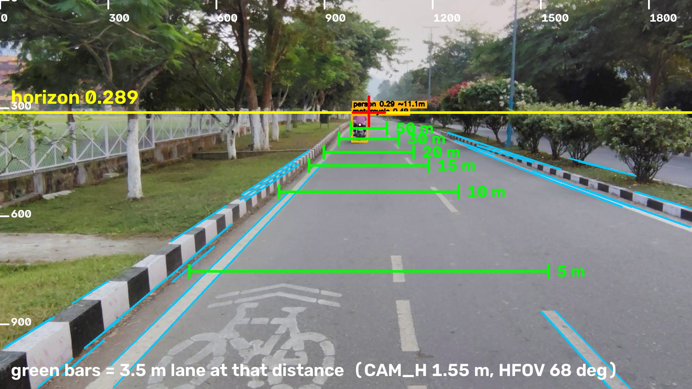

# Calibration

What makes distance and speed right.

    python tools/calibrate.py rs2_20min.mp4                  # -> prints settings + calib_out/calib_overlay.png
    python tools/calibrate.py rs2_20min.mp4 --speed-kmh 30   # if you know the average speed -> solves CAM_H
    python tools/replay.py rs2_20min.mp4 --calib calib_out/calibration.json   # annotated video + CSV, on the laptop

| setting | meaning | how to get it | DriveCache (phone on the i20 roof); stock clips have no known values |
|---|---|---|---|
| HORIZON | row of the horizon, 0 = top | vanishing point of lane lines / kerbs (calibrate.py), cross-checked by optical flow | **0.29** (measured 0.289-0.314 on 4 clips) |
| CAM_H | lens height above road, m | tape measure; or `--speed-kmh`; or `--lane` | **1.55** (roof ~1.5 m + mount) |
| HFOV | horizontal field of view of the video, deg | camera spec / calibrate presets | **68** (phone main camera, 16:9) |
| FOE_X | column the car drives towards | flow FOE while driving straight / VP x on a straight road | **0.52** (measured 0.52-0.53 on a straight road) |
| EGO_MODE | own speed source | auto = laptop optical flow, else the "my speed" box | auto |

Why the horizon matters most: ground distance is f*CAM_H/(y_bottom - y_horizon). With the old default 0.45 on
DriveCache, everything farther than ~13 m sits *above* the assumed horizon, so the road-plane estimate is dropped
and only the (noisier) size estimate is left. 1 % of image height of horizon error is ~15-20 % distance error at 30 m.
Check on the overlay: the green bars are 3.5 m wide at 5/10/20/30/50 m. Too wide for your lane -> CAM_H too small.
Per clip, re-run calibrate.py: the horizon moves a few % between mountings and on slopes.

*Output of `tools/calibrate.py` on a DriveCache clip: yellow = horizon, green bars = 3.5 m lane width at 5/10/20/30/50 m.*
