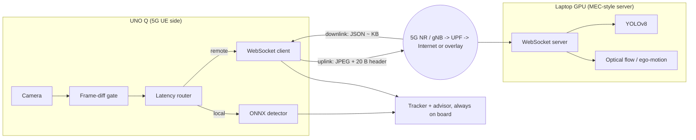
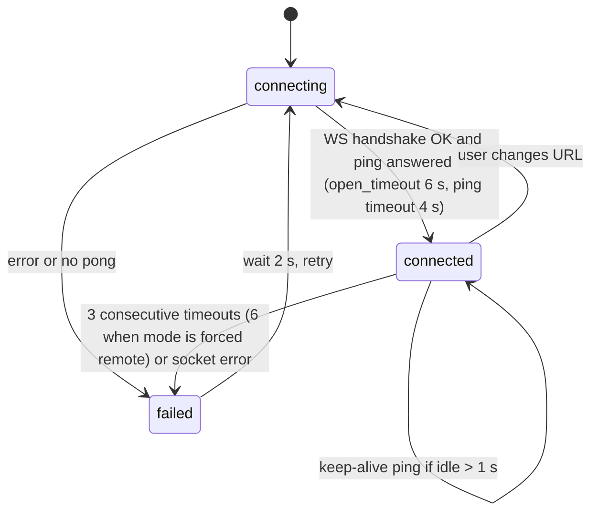

# Board <-> laptop protocol

This document specifies the application protocol between the **UNO Q** (client, edge) and the **laptop GPU server** (server, MEC-style
compute node), and explains how it behaves on a 5G / Wi-Fi / LAN path. It is written against the code in
[`unoq_app/python/remote.py`](../unoq_app/python/remote.py), [`unoq_app/python/main.py`](../unoq_app/python/main.py) and
[`laptop/server.py`](../laptop/server.py); where the older docs disagree with the code, the code (and this file) wins.

---

## 1. Protocol stack

| Layer | Protocol | Notes |
|---|---|---|
| Application | **VPU protocol v1/v2** (this document) | binary frames up, JSON results down |
| Session | **WebSocket**, RFC 6455, `ws://` port **8765** | message-oriented, full duplex, per-message compression **disabled** (`compression=None`) |
| Transport | **TCP** | reliable, ordered; one connection per board |
| Network | IP (IPv4) | Tailscale / ZeroTier overlay, or a plain LAN address |
| Access | **5G NR** (UE <-> gNB), Wi-Fi, or Ethernet | whatever carries the IP traffic; the application is access-agnostic |



**Traffic profile.** The link is *uplink-heavy*: the board uploads images (tens of KB per frame) and downloads only small JSON results.
This matters for 5G because NR TDD frame structures typically allocate far more slots to downlink than uplink, so the direction we need
most is the one with less capacity (see section 7).

---

## 2. Roles and connection lifecycle

The **board is the client**; the laptop only listens. The client keeps one persistent WebSocket and a background thread owns its life cycle,
so the video pipeline never blocks on the network.



* **Handshake.** Standard WebSocket HTTP upgrade. If the server was started with `--token SECRET`, the URL must contain `?token=SECRET`;
  a wrong or missing token makes the server close with code **1008** (policy violation) before any application message.
* **Version negotiation.** Immediately after connecting, the client sends `{"ping": n}`. The server answers `{"pong": n, "v": 2}`.
  A pong without `v` (an old server) means **v1**. The client then uses v1 or v2 framing for the whole connection. Old boards
  (v1 frames) also still work against a new server, because the server decides per message (section 3.1).
* **Readiness.** The client reports the link as usable only if a socket exists, fewer than 2 consecutive failures occurred and at least one RTT
  sample exists. The router never offloads before that.
* **Keep-alive.** If no frame was sent and no ping was sent for 1 s, the client pings (worker wakes every 0.4 s). While running locally
  this is the only source of RTT; while offloading, RTT comes from real frames (section 5).
* **Reconnect.** Fixed 2 s retry interval, no exponential back-off. The tracker keeps running on local inference meanwhile, so IDs are not reset.

---

## 3. Message formats

All multi-byte integers and floats in binary messages are **big-endian (network order)**, packed with Python `struct` format `!`
(no padding). Boxes and other image coordinates are **normalised to 0..1**.

### 3.1 Uplink frame (client -> server, WebSocket *binary* message)

**v2 (default):**

| Offset | Size | Field | Type | Meaning |
|---:|---:|---|---|---|
| 0 | 4 | `magic` | ASCII | `"VPU2"` - marks a v2 frame |
| 4 | 4 | `frame_id` | uint32 | monotonically increasing request id, echoed in the reply |
| 8 | 8 | `capture_time_s` | float64 | board-local monotonic clock (s) at capture; only **differences** are used (flow `dt`), so no clock sync is needed |
| 16 | 4 | `source_generation` | uint32 | increments when the video source changes or a file loops; the server drops its previous-frame state when it changes |
| 20 | N | `jpeg` | bytes | JPEG image |

**v1 (legacy):** `[uint32 frame_id][jpeg]` - 4-byte header, no capture time, so the server cannot compute ego-motion or looming.

*Discrimination rule:* a message whose first 4 bytes equal `"VPU2"` is v2, otherwise v1. Caveat: a v1 `frame_id` equal to `0x56505532`
(about 1.45 billion) would be misread as v2; the id counter starts at 0 and the board sends a few frames per second, so this is unreachable in practice,
but a future v3 should use an explicit version byte or a WebSocket subprotocol (`Sec-WebSocket-Protocol`) instead of an in-band magic.

Image size is adaptive (section 6): 480 / 384 / 320 / 256 / 192 px wide, JPEG quality 60 / 55 / 50 / 50 / 45. The server accepts up to
`max_size = 4 MiB` per message.

### 3.2 Calibration update (client -> server, JSON text)

```json
{"cal": {"hfov": 68, "cam_h": 1.55, "horizon": 0.29, "foe_x": 0.52}}
```

Sent **before the next frame** whenever the calibration changed (and once per new connection). `hfov` in degrees, `cam_h` in metres,
`horizon` and `foe_x` as image fractions. A change of `horizon`, `foe_x` or `hfov` makes the server discard learned horizon offsets.
It is per-connection state; there is no reply.

### 3.3 Ping / pong (RTT probe and version negotiation)

```
client -> {"ping": n}
server -> {"pong": n, "v": 2}
```

`n` is a client counter; the client discards any pong whose `n` does not match (stale replies from earlier timeouts).

### 3.4 Detection reply (server -> client, JSON text)

```json
{
  "id": 412,
  "dets": [["car", 0.91, 0.42, 0.51, 0.58, 0.66]],
  "ext":  [{"loom": 0.21, "loom_sd": 0.04, "u": -0.003, "v": 0.001, "u_sd": 0.002, "n": 83}],
  "ego":  {"ok": true, "v": 12.4, "v_sd": 0.5, "yaw": 0.01, "pitch": 0.0, "horizon": 0.291, "horizon_fit": 0.293, "foe_x": 0.52},
  "yolo_ms": 9.8, "motion_ms": 14.2, "infer_ms": 21.7
}
```

| Field | Present | Meaning |
|---|---|---|
| `id` | always | echoes `frame_id`; the client accepts only the reply whose `id` equals the request it is waiting for |
| `dets` | always | list of `[class, confidence, x1, y1, x2, y2]`; classes: person, bicycle, car, motorcycle, bus, truck |
| `ext` | v2 + motion on | one entry per detection (or `null`): `loom` = 1/TTC in 1/s, `loom_sd`, rotation-free image velocity `u`,`v` (+ `u_sd`), `n` = pixels used; optional `z`, `z_rel` with `--depth` |
| `ego` | v2 + motion on | own motion: `ok`, speed `v` (m/s) and `v_sd`, `yaw`, `pitch`, dynamic `horizon`, `horizon_fit`, `foe_x`; `null` or `ok:false` if the frame pair was unusable |
| `yolo_ms`, `motion_ms` | v2 | detector time and optical-flow + fit time on the server |
| `infer_ms` | always | **total server-side time** for this frame (decode + detect + motion). The client subtracts it from the measured round trip |
| `err` | on failure | e.g. `"bad jpeg"`; with `dets: []` and `infer_ms: 0` |

Everything beyond `id`, `dets` and `infer_ms` is **optional by design**: fields may be `null` (first frame, a time gap above 0.35 s, a looped video,
too little texture) and a client must tolerate their absence. The board merges `ext[i]` into `dets[i]` as a 7th element for the tracker.

### 3.5 Message summary

| Direction | Type | Format | Answered by |
|---|---|---|---|
| C -> S | frame v2 / v1 | binary | detection reply (matching `id`) |
| C -> S | `cal` | JSON | nothing |
| C -> S | `ping` | JSON | `pong` |
| S -> C | detection reply | JSON | - |
| S -> C | `pong` | JSON | - |

---

## 4. Exchange pattern (stop-and-wait)

The protocol is **one request in flight per connection**. On the client a lock serialises pings and frames; the server handles a connection's
messages sequentially. A stop-and-wait scheme is deliberate: it keeps the newest-frame-only behaviour of the camera (no queue builds up and no stale
frames are processed), at the price of throughput limited to `1 / RTT_total` frames per second.

```mermaid
sequenceDiagram
    participant B as UNO Q (client)
    participant L as Laptop (server)
    B->>L: WS upgrade (+ ?token=...)
    B->>L: {"ping": 1}
    L-->>B: {"pong": 1, "v": 2}  (client sets v2, RTT sample)
    B->>L: {"cal": {...}}
    B->>L: binary: VPU2 | id=1 | t | gen | JPEG
    Note over L: decode, then YOLO and optical flow in parallel, then ego-motion fit
    L-->>B: {"id": 1, "dets": [...], "ext": [...], "ego": {...}, "infer_ms": 21.7}
    Note over B: rtt = total - infer_ms; the tracker consumes the result
    B->>L: binary: ... id=2 ...
    Note over B: no reply within timeout, so the frame is run locally and a smaller size is used next
    L-->>B: {"id": 2, ...} arrives late
    B->>L: binary: ... id=3 ...
    L-->>B: {"id": 2, ...} (stale, skipped because id differs)
    L-->>B: {"id": 3, ...}
```

Matching by `id` / `n` is what makes late replies harmless: a stale reply is read and dropped while waiting for the current one.

---

## 5. Latency measurement and the offload decision

### 5.1 What is measured

| Quantity | How | Smoothing |
|---|---|---|
| `ping_rtt` | wall time of a ping/pong (pure network + stack delay, no GPU) | EWMA, alpha = 0.3 |
| `infer` | `infer_ms` from the server reply | EWMA, alpha = 0.3 |
| `rtt` | idle: ping time. While offloading: `(frame round trip) - infer_ms`, i.e. **uplink transfer + downlink + network** | EWMA, alpha = 0.3 |
| `enc_ms` | JPEG resize + encode time on the board | EWMA |
| `local_ms` | measured local ONNX inference time (re-probed every 20 s while offloading) | - |

Estimated end-to-end cost of using the laptop:

```
remote_est = rtt + infer + enc_ms
```

Because `rtt` while offloading includes the time to push the JPEG through the uplink, it grows automatically when the uplink gets
congested - that is the effect a 5G link with poor uplink radio conditions produces, and the router sees it without any radio-layer information.

### 5.2 Router (mode `auto`)

```
if link not ready                  -> local
elif local model unavailable       -> remote
else  lim = min(MAX_REMOTE_MS, REMOTE_BIAS * local_ms)         # defaults: 800 ms, 4.0
      local  -> remote   when remote_est <  lim
      remote -> local    when remote_est >  1.3 * lim          # hysteresis
```

* Modes: `auto`, `local` (forced), `remote` (forced; never touches the local model).
* **Hard timeout per offloaded frame:** `clamp(3 x remote_est, 0.6 s, 2.0 s)` in auto mode (`clamp(4 x remote_est, 1.5 s, 4.0 s)` when forced).
  On timeout or socket loss in auto mode the **same frame is run locally** and the mode flips to local immediately.
* Tracking, distance, speed and advice **always run on the board**, so a path change never resets track IDs.
* **Frame-diff gate** (before the router): a frame is only processed if a 64x36 grey thumbnail differs from the last processed one by more than
  `thr` (default 3.0), or if `max_age` (default 0.5 s, UI-adjustable 0.1-5 s) has passed. This limits uplink load for static scenes.

> The older `how-it-works.md` quotes 0.8x / 1.1x switching and a 120-350 ms timeout. The values above are what the current code uses.

### 5.3 Why the timestamps matter

The server computes optical flow between consecutive frames of the same connection and `source_generation`. It refuses pairs more than
**0.35 s** apart (`MAX_DT`) or with a changed generation. So uplink latency *and* the gate's `max_age` directly bound how often motion
analysis is available; motion works best at >= 10 offloaded frames/s.

---

## 6. Rate adaptation (uplink load control)

The client walks a five-step ladder of (width, JPEG quality):

| Level | Width | Quality | JPEG size* | Uplink at 10 fps | Uplink at 30 fps |
|---:|---:|---:|---:|---:|---:|
| 0 | 480 | 60 | 24.5 KB | 2.0 Mbit/s | 6.0 Mbit/s |
| 1 | 384 | 55 | 15.9 KB | 1.3 Mbit/s | 3.9 Mbit/s |
| 2 | 320 | 50 | 11.2 KB | 0.9 Mbit/s | 2.8 Mbit/s |
| 3 | 256 | 50 | 8.1 KB | 0.7 Mbit/s | 2.0 Mbit/s |
| 4 | 192 | 45 | 4.8 KB | 0.4 Mbit/s | 1.2 Mbit/s |

\* Approximate; the real size depends on scene content. Header overhead (20 B) is negligible; TCP/IP/WebSocket framing adds a few percent.
Replies are small JSON (typically well under a few KB).

Rules (all in `Pipeline` in `main.py`):

* **Down one level** after a timeout / lost reply, or after 4 consecutive "slow" frames, where slow means
  `last_total > 2 x ping_rtt + 400 ms` (transfer time dominates over bare network delay).
* **Up one level** after 15 consecutive "cheap" frames: `last_total < 1.5 x ping_rtt + 120 ms`.
* Otherwise the counters reset. This is a simple AIMD-like controller driven by measured delay, not by radio-layer feedback.

---

## 7. Behaviour on 5G

These are the properties of a 5G path that the protocol is designed around.

| 5G property | Effect on this protocol | How the design copes |
|---|---|---|
| **Uplink/downlink asymmetry** (TDD slot pattern, UE power limits) | JPEG upload is the bottleneck, not the tiny JSON reply | frame size ladder; frame-diff gate; `rtt` includes transfer time, so congestion shows up in the router's estimate |
| **Variable RTT** (scheduling requests and grants on the uplink, HARQ retransmissions, handover, mobility) | per-frame latency jitter; occasional spikes | EWMA estimate + hysteresis (1.3x) + hard timeout with local fallback for that frame |
| **Radio link blockage / coverage hole / RRC state change** | TCP stalls, then the socket dies | timeout -> local fallback, reconnect every 2 s, tracker state preserved |
| **TCP over a lossy, time-varying radio link** | retransmissions and **head-of-line blocking**: one lost segment delays every later message on the connection | stop-and-wait means at most one frame is exposed; stale replies are discarded by `id`. A UDP/QUIC-based transport would remove HoL blocking (future work) |
| **NAT / CGNAT in the mobile core, no inbound connections to the UE** | server cannot reach the board and, usually, board-to-laptop needs a reachable address | board is the **client**; the laptop is reached through an overlay (Tailscale / ZeroTier) or a reachable address. This is also why the app uses outbound WebSocket |
| **QoS flows** (5QI, TS 23.501) | the default bearer is best effort (non-GBR, e.g. 5QI 9) with no delay guarantee | currently *no* QoS request: traffic uses the default flow. A delay-critical GBR flow (5QI 82-85 range) or a dedicated slice / local UPF + MEC would be the way to turn "adaptive" into "bounded"; this needs operator/core support and is outside the app |
| **Edge placement (MEC)** | RTT to a laptop on the same LAN is a few ms; to a cloud region over the internet, tens of ms | the laptop plays the MEC role; the router treats both identically via measured RTT |

Typical latency components of an offloaded frame, which map onto the logged numbers:

```
frame round trip (measured from send) = t_uplink + t_network + infer_ms + t_downlink
rtt  (as logged)  = round trip - infer_ms     -> uplink transfer + network + downlink
remote_est        = rtt + infer + enc_ms      -> adds the board-side JPEG encode time
```

---

## 8. Errors, robustness and security

| Situation | Behaviour |
|---|---|
| Undecodable JPEG | server replies `{"id", "infer_ms": 0, "dets": [], "err": "bad jpeg"}` and continues. *Current client does not inspect `err`; it treats the reply as a valid empty detection list.* |
| Detector or motion exception | server logs it; reply still sent (empty `dets`, or without `ego`/`ext`) |
| No reply in time | client counts a timeout, falls back locally, drops to a smaller frame size; the connection is closed after 3 consecutive failures (6 when forced remote) |
| Server restart / link drop | client reconnects every 2 s; server logs `client connection lost` and keeps listening |
| Bad / missing token | server closes with WebSocket code 1008 |
| Oversized message | rejected by the WebSocket layer (`max_size` 4 MiB) |
| Stale or out-of-order reply | skipped (`id` / `n` mismatch) |
| Server-only v1 client | works: no `ext`/`ego` in replies |

**Security (honest status).**

* Transport is plain `ws://`: no TLS. Video frames and the token are not encrypted by the application. Over 5G NR the *air interface* is
  ciphered and integrity-protected between UE and gNB, but that does not protect the path beyond the RAN. Over Tailscale (WireGuard) the whole
  path is encrypted; on a bare LAN or the public internet it is not.
* The token is a **shared secret in the URL query string** and the server checks it by substring match on the request path (`token=<secret>` anywhere in the path).
  It is a convenience gate for a lab setup, not strong authentication. Use an overlay VPN or add TLS (`wss://`) plus a header-based token for anything beyond that.
* The server binds to `0.0.0.0:8765`; restrict it with the firewall to the overlay interface (as `setup.md` suggests).

---

## 9. Known limitations

* TCP head-of-line blocking; try QUIC / WebTransport or UDP with an application ACK.
* No pipelining: stop-and-wait caps throughput at `1 / RTT_total`; an `N`-deep window with newest-wins dropping would raise it.
* In-band magic for versioning; a WebSocket subprotocol or version byte would be cleaner.
* Client ignores `err` in replies; token and TLS as discussed in section 8.
* No QoS-flow request or network-slice awareness.
* RTT is the only network signal; 5G modem metrics (RSRP / SINR, CQI) are not used by the router.

Reference: RFC 6455 (WebSocket), RFC 9293 (TCP), 3GPP TS 23.501 (5G system architecture, QoS model).
