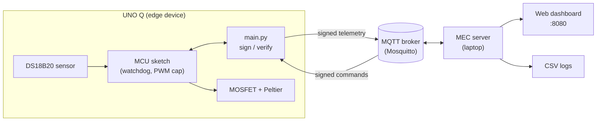

# Cold-Chain Zero-Trust Prototype

**Tamper-resistant temperature monitoring and cooling control for a cold-chain box, built on an Arduino UNO Q (edge) and a laptop acting as a Multi-access Edge Computing (MEC) server.**

A sensor on the edge device reports temperature. A server decides whether to cool. Every message in both directions is cryptographically signed and checked for replay, so a rogue device on the network can neither fake a "safe" reading nor switch the cooler on or off.

You can run the **whole system on one computer with no hardware** (simulated sensor and cooler), then move to a real UNO Q, DS18B20 sensor and Peltier cooler when you have them. Only one file (`hardware.py`) and one Arduino sketch deal with hardware.

---

## Contents

- [Why this exists](#why-this-exists)
- [How it works](#how-it-works)
- [Repository layout](#repository-layout)
- [Quick start (no hardware, one machine)](#quick-start-no-hardware-one-machine)
- [Run it for real: UNO Q + laptop](#run-it-for-real-uno-q--laptop)
- [Configuration reference](#configuration-reference)
- [The dashboard](#the-dashboard)
- [Security model](#security-model)
- [Testing](#testing)
- [Attack demos](#attack-demos)
- [Fault handling](#fault-handling)
- [Adding real hardware](#adding-real-hardware)
- [Latency measurement](#latency-measurement)
- [Troubleshooting](#troubleshooting)
- [Limitations and hardening](#limitations-and-hardening)

---

## Why this exists

Vaccines, medicines and food are only safe if they stay inside a temperature band for the whole journey. If the telemetry channel can be spoofed, replayed or tampered with, the data (and any automatic cooling based on it) can't be trusted.

This project demonstrates a **zero-trust** approach on a small, understandable scale: nothing on the network is trusted just because it arrived. Each message must prove who sent it (HMAC signature), that it's fresh (timestamp), and that it isn't a recording of an old message (sequence number / nonce that survives reboots).

It is a learning and demo project, **not a certified medical or food-safety system**. See [Limitations](#limitations-and-hardening).

## How it works



The control loop, every 3 seconds:

1. **Edge** reads the temperature and publishes a signed telemetry packet.
2. **Server** verifies it (signature, device, freshness, sequence). Rejected packets are counted, shown as an attack on the dashboard, and never used.
3. **Server** runs the controller (a hysteresis band: cool on at 6.5 °C, off at 4.5 °C) and publishes a signed `set_cooling` command.
4. **Edge** verifies the command, **saves the nonce to disk first**, and only then drives the cooler.
5. **Edge** reports a signed `command_accepted` / `command_rejected` event, which the server uses to measure latency and the dashboard displays.

If the server goes silent for 30 s, the edge falls back to a simple local rule (cool if ≥ 7 °C) until valid commands resume.

### Messages

Every message, in both directions, has the same envelope:

```json
{ "payload": { "...": "..." }, "sig": "<hex HMAC-SHA256 of the canonical payload>" }
```

"Canonical" means `json.dumps(payload, sort_keys=True, separators=(",", ":"))`, so both sides sign identical bytes.

| Topic | Direction | Payload fields |
|---|---|---|
| `coldchain/uno_q_edge_01/telemetry` | edge → server | `device_id, seq, timestamp, temperature` |
| `coldchain/uno_q_edge_01/commands` | server → edge | `device_id, nonce, timestamp, command="set_cooling", pwm` (0–255) |
| `coldchain/uno_q_edge_01/events` | edge → server | `device_id, timestamp, event, ...` (`command_accepted`, `command_rejected`, `sensor_fault`, `actuator_error`) |

## Repository layout

```
cold-chain/
├── uno_q/                     # runs on the Arduino UNO Q
│   ├── main.py                # sample → sign → publish; verify commands → actuate; local fail-safe
│   ├── hardware.py            # hardware abstraction: read_temperature(), set_cooling_power(), simulator
│   ├── security.py            # HMAC, command validation, persistent nonce store, atomic writes
│   ├── telemetry.py           # builds signed telemetry with a persistent sequence number
│   ├── provision_state.py     # one-time (or recovery) creation of the nonce file
│   ├── config.py              # settings from environment variables or local_settings.json
│   ├── local_settings.example.json
│   ├── requirements.txt       # paho-mqtt
│   ├── sketch/sketch.ino      # MCU firmware: DS18B20 read, PWM output, safety watchdog
│   └── tests/
├── mec_server/                # runs on the laptop / edge server
│   ├── server.py              # verify telemetry → decide → publish signed commands
│   ├── security.py            # HMAC verification, telemetry replay guard, command counter
│   ├── controller.py          # cooling decision logic with hysteresis (pure logic, no I/O)
│   ├── logger.py              # console/file logs + CSV of verified telemetry and latency
│   ├── dashboard.py / .html   # read-only live web dashboard (standard library only)
│   ├── config.py
│   └── tests/
└── tools/                     # helpers and attack simulators
    ├── hello_publish.py       # "can this machine reach the broker?"
    ├── attack_telemetry.py    # sends 1 valid + 7 malicious telemetry packets
    ├── replay_attack.py       # captures a real message and replays it
    └── send_test_command.py   # hand-crafted commands (tampered, stale, wrong key, ...)
```

> `uno_q/` and `mec_server/` each contain a `security.py` and `config.py` with the same names. Always run commands from **inside** the relevant folder, and run each folder's tests separately.

---

## Quick start (no hardware, one machine)

This runs the broker, the server, the simulated edge device and the dashboard on one computer. It takes about 5 minutes.

### 1. Prerequisites

- **Python 3.9+** (developed and tested with 3.12)
- **Mosquitto** MQTT broker:
  - macOS: `brew install mosquitto`
  - Debian/Ubuntu: `sudo apt install mosquitto mosquitto-clients`
  - Windows: installer from [mosquitto.org](https://mosquitto.org/download/), then add it to your `PATH`

### 2. Install

```bash
git clone <this-repo-url> cold-chain
cd cold-chain
python -m venv .venv
source .venv/bin/activate          # Windows: .venv\Scripts\activate
pip install paho-mqtt pytest
```

### 3. Start the broker (terminal 1)

Create `mosq.conf` anywhere:

```
listener 1883 127.0.0.1
allow_anonymous true
```

```bash
mosquitto -c mosq.conf -v
```

### 4. Set the shared secret and simulation flags

Set these in **every** terminal below (the secret must be identical on server and edge):

| | macOS / Linux | Windows PowerShell |
|---|---|---|
| secret | `export COLDCHAIN_KEY="any-long-random-string"` | `$env:COLDCHAIN_KEY="any-long-random-string"` |
| simulate sensor | `export SENSOR_SIMULATION=1` | `$env:SENSOR_SIMULATION="1"` |
| run as plain script | `export COLDCHAIN_STANDALONE=1` | `$env:COLDCHAIN_STANDALONE="1"` |

> **Important:** `SENSOR_SIMULATION` defaults to **off** (the code assumes a real sensor). Without it, the edge app logs `SENSOR FAULT` and sends no telemetry. The cooler is simulated by default (`COOLING_SIMULATION`).

### 5. Start the server (terminal 2)

```bash
cd mec_server
python server.py
```

It prints `Dashboard: http://127.0.0.1:8080`.

### 6. Provision and start the simulated edge device (terminal 3)

```bash
cd uno_q
python provision_state.py     # once: creates the persistent nonce file (last_nonce=0)
python main.py
```

### 7. Check it works

- **Terminal 2** shows lines like `ACCEPTED seq=… temp=5.23C -> pwm=0`, `SENT command …`, and `LATENCY command round-trip … ms`.
- **http://localhost:8080** shows a green **SECURE** card. The simulated box warms about 0.25 °C per sample; at 6.5 °C the card turns blue (**COOLING**), the temperature falls to 4.5 °C, and it returns to green. That is the closed loop.
- `mec_server/logs/telemetry.csv` gains a row for every verified reading.

### 8. Try an attack

Stop the edge app (Ctrl+C in terminal 3), then:

```bash
cd tools
python attack_telemetry.py --host localhost
```

You'll see 1 packet accepted and 7 rejected in the server log (bad signature, replay, missing signature, stale timestamp, malformed JSON), and the dashboard turns red for 10 seconds. More in [Attack demos](#attack-demos).

---

## Run it for real: UNO Q + laptop

### Hardware you need

| Part | Notes |
|---|---|
| Arduino UNO Q | Runs `uno_q/` (Linux-side Python) and the sketch (MCU side) |
| DS18B20 temperature sensor | Data → pin `2` (`ONE_WIRE_BUS`), **4.7 kΩ pull-up** between data and 3.3 V |
| Peltier module + driver | Driver input → PWM pin `5` (`COOLING_PIN`). See the [driver warning](#adding-real-hardware) |
| Laptop | Runs the broker, server and dashboard; same network as the board |

You can adopt this in stages: real network with simulated sensor/cooler first, then real sensor, then real cooler.

### Steps

1. **Network.** Put the laptop and the board on the same Wi-Fi/hotspot. Find the laptop's IP (`ipconfig` / `ip addr`), referred to below as `LAPTOP_IP`.
2. **Broker on the laptop.** Same as the quick start, but listen on all interfaces and open TCP **1883** in the firewall:
   ```
   listener 1883 0.0.0.0
   allow_anonymous true
   ```
   This is anonymous plaintext MQTT: fine on a private test network, not beyond. See [hardening](#limitations-and-hardening).
3. **Check the board can reach the broker.** Copy `tools/hello_publish.py` to the board and run `python3 hello_publish.py LAPTOP_IP`. You should see `OK: broker reachable`.
4. **Copy the whole `uno_q/` folder to the board** (the modules import each other, so keep the files together):
   ```bash
   scp -r uno_q arduino@<board>.local:~/coldchain/
   ```
5. **Install the dependency on the board:** `pip install "paho-mqtt>=2.0"` (use a virtualenv if system pip is locked down).
6. **Configure the board.** Either export variables in your SSH shell or, if the app is launched by Arduino App Lab (which does *not* see your shell's `export` lines), copy `local_settings.example.json` to `local_settings.json` and edit it:
   ```json
   {
     "MQTT_HOST": "LAPTOP_IP",
     "COLDCHAIN_KEY": "your-own-long-random-secret",
     "COLDCHAIN_STATE_DIR": "/home/arduino/coldchain_state"
   }
   ```
   Set the same `COLDCHAIN_KEY` on the laptop. **Replace the example key; never commit your real one.**
7. **Provision the nonce file once** on the board: `python3 provision_state.py`.
8. **Start the server** on the laptop (`cd mec_server && python server.py`), then the **app** on the board (`cd ~/coldchain/uno_q && python3 main.py`).

**Sensor and Bridge note.** The real sensor and cooler are reached through the Arduino *Bridge*, which only exists when the app is started by Arduino App Lab (or `arduino-app-cli app start`), not from a plain SSH shell. For SSH-only testing, use `SENSOR_SIMULATION=1` and `COLDCHAIN_STANDALONE=1`. With App Lab, make sure `requirements.txt` (containing `paho-mqtt>=2.0`) sits next to `main.py`; if the log says `No module named 'paho'`, App Lab did not install it. App Lab layouts vary between versions; if its Python entry-point API differs, only the last ~10 lines of `main.py` need adjusting.

**Clocks matter.** Timestamps are accepted within ±30 s. Keep both machines on NTP time, or you'll see `stale/future timestamp` rejections.

---

## Configuration reference

Settings are read from **environment variables**, and (on the board only) from `local_settings.json`. Environment variables win.

| Variable | Where | Default | Meaning |
|---|---|---|---|
| `MQTT_HOST` | both | `localhost` | Broker address (the laptop's IP, from the board's point of view) |
| `MQTT_PORT` | both | `1883` | Broker port |
| `COLDCHAIN_KEY` | both | `change-me-demo-key` | Shared HMAC secret. **Must match on both sides.** Always set your own |
| `SENSOR_SIMULATION` | board | `false` | `1` = simulated temperature; otherwise real DS18B20 via Bridge |
| `COOLING_SIMULATION` | board | `true` | `false` = drive the real cooler via Bridge |
| `COLDCHAIN_STATE_DIR` | board | `uno_q/state/` | Where the nonce and sequence files live |
| `COLDCHAIN_STANDALONE` | board | unset | `1` = run as a plain script instead of through App Lab |
| `DASHBOARD_HOST` | server | `127.0.0.1` | Set `0.0.0.0` to view from another device (no login, so private networks only) |
| `DASHBOARD_PORT` | server | `8080` | Dashboard port |

Tunable policy values live in the `config.py` files:

| Value | File | Default |
|---|---|---|
| Safe band (alarms) | `mec_server/config.py` | `SAFE_LOW_C=2.0`, `SAFE_HIGH_C=8.0` |
| Cooling hysteresis | `mec_server/config.py` | on at `6.5` °C, off at `4.5` °C |
| PWM range / gain | `mec_server/config.py` | min `120`, max `255`, `+60` per °C above the on-threshold |
| Allowed clock skew | both | `30` s |
| Sample period | `uno_q/config.py` | `3` s |
| Server-silent fail-safe | `uno_q/config.py` | after `30` s; cools at PWM `200` if ≥ `7.0` °C |
| Simulator behaviour | `uno_q/config.py` | start 4.5 °C, +0.25 °C/sample, door-open spike every 40 samples |

The thresholds are example project values, not a medical specification.

---

## The dashboard

`server.py` serves a read-only dashboard at **http://localhost:8080** (standard library only, nothing extra to install).

| Card colour | Meaning |
|---|---|
| 🟢 **SECURE** | Verified telemetry is arriving, cooling is off |
| 🔵 **COOLING** | The cooler is on |
| 🔴 **ATTACK** | A message was rejected in the last 10 s |
| ⚪ **OFFLINE** | No verified telemetry for 10 s |

It also shows temperature, cooling output, a live chart with the safe band and thresholds, security counters, latency statistics and an event log. **Only verified data is ever plotted**; rejected packets are counted but never displayed as readings.

A JSON version of the same state is at `/api/state`. To open it from a phone, set `DASHBOARD_HOST=0.0.0.0`, restart the server, allow TCP 8080, and visit `http://LAPTOP_IP:8080`. There is no authentication.

---

## Security model

### What is protected, and how

| Threat | Defence |
|---|---|
| Forged or modified message | HMAC-SHA256 over a canonical encoding; compared in constant time |
| Replay of a captured telemetry packet | Strictly increasing `seq` per device, saved to disk |
| Replay of a captured command | Strictly increasing `nonce`, saved to disk **before** actuating |
| Replay after a reboot | Both counters persist (atomic write + fsync), so restarts don't reopen the window |
| Delayed replay | Timestamp freshness window (30 s) |
| Command meant for another device | `device_id` must match |
| Oversized or malformed input | 4 KB size cap, strict field/type/range checks |
| Impossible sensor values | Plausible range check; the sensor layer rejects `-127` (disconnected) and `85.0` (power-on default) instead of passing them on |
| Corrupt or missing state file | **Fail closed:** the board refuses all commands until a human runs `provision_state.py --force`. It never silently resets to 0 |

### Validation order

**Commands on the board** (`uno_q/security.py: verify_command`):
size → JSON → envelope → **HMAC** → exact field set → command name → PWM range → device id → timestamp freshness → nonce strictly greater → **persist nonce** → *only then* actuate. If persisting fails, nothing is actuated.

**Telemetry on the server:** size → JSON → envelope → **HMAC** → topic matches `device_id` → known device → field/type checks → plausible temperature → freshness → `seq` strictly greater → persist `seq` → controller.

The HMAC is checked before any field is trusted.

### Why both timestamps and counters?

Timestamps depend on clocks being right; counters don't. Using both means a wrong clock causes rejections (safe) rather than acceptance, and a replay inside the time window is still caught by the counter.

### Seeding

If the server's counter file or the board's sequence file is missing, it's seeded from the current Unix time so new values are larger than anything issued before. The board's *command nonce* file is different: it is only created by `provision_state.py`, deliberately, as a trusted step.

---

## Testing

```bash
# Server side: 34 tests (HMAC, tamper, replay, sequence persistence, controller, latency)
cd mec_server && python -m pytest -q

# Edge side: 27 tests (commands, nonce persistence, corrupt state, hardware layer, sensor faults)
cd ../uno_q && python -m pytest -q
```

Run them separately (both folders have a `security.py`). They need no network, broker or hardware. `test_replay_rejected_after_restart` covers the key scenario: accept nonce 17, restart, resend 17 → rejected, send 18 → accepted.

---

## Attack demos

Run with the server, broker and (for most) the edge app running, with the dashboard open. Each of these should produce a red **ATTACK** card and a rejection in the log. Run them from `tools/` with `COLDCHAIN_KEY` set.

| # | Attack | Command | Expected rejection |
|---|---|---|---|
| 1 | Replay a real reading | `python replay_attack.py --kind telemetry` | replayed/old seq |
| 2 | Telemetry attack suite | `python attack_telemetry.py` | bad signature / missing signature / stale timestamp / malformed JSON / replay |
| 3 | Replay a real cooling command | `python replay_attack.py --kind command` | replayed/old nonce |
| 4 | Late replay | `python replay_attack.py --kind command --delay 40` | stale/future timestamp |
| 5 | Tampered command | `python send_test_command.py --nonce 1000 --pwm 100 --tamper` | bad signature |
| 6 | Unsigned command | `python send_test_command.py --nonce 1000 --pwm 100 --no-sig` | missing signature |
| 7 | Wrong key / device / stale | add `--wrong-key`, `--wrong-device`, or `--stale` | bad signature / another device / stale timestamp |
| 8 | Valid signature, old nonce | `python send_test_command.py --nonce 1000 --pwm 100` | replayed/old nonce |
| 9 | Server goes silent | stop `server.py` for >30 s | board logs `LOCAL FAIL-SAFE active` |

`attack_telemetry.py` sends 8 packets: 1 valid and 7 attacks. If the real edge app is running, packet 1 may show as a replay because it races the real device; that's fine.

### Testing nonce persistence by hand

1. Stop the server so only your commands arrive; start the edge app.
2. Reset the board's nonce (a trusted action): `cd uno_q && python provision_state.py --force --nonce 0`, then restart the edge app.
3. `python send_test_command.py --nonce 1000 --pwm 150` → accepted.
4. Restart the edge app, then send nonce `1000` again → **rejected**, even after the restart. Nonce `1001` → accepted.
5. Inspect `last_nonce.json` in the state directory: it holds `1001`. Rejected commands never change it and never reach the cooler.

> ⚠️ **Never send a manual command with a nonce larger than the server's current counter** (a Unix-time-sized number, around 1.79 billion in late 2026). A validly signed command with a huge nonce would be accepted, and every later server command would then be rejected as old. Keep manual nonces small (like `1000`). If you do break it, delete `mec_server/state/command_nonce.json` and the server will reseed from the clock.

---

## Fault handling

| Scenario | How to trigger | Expected behaviour |
|---|---|---|
| Broker goes down | Stop Mosquitto | Both sides log `Disconnected … will retry`; the board skips telemetry (sequence numbers aren't wasted) |
| Broker returns | Restart Mosquitto | Both reconnect and re-subscribe automatically |
| Server silent | Stop the server for >30 s | Board logs `LOCAL FAIL-SAFE active`; cools locally if ≥ 7 °C; recovers on the next valid command |
| Garbage command | `mosquitto_pub -t coldchain/uno_q_edge_01/commands -m junk` | `COMMAND REJECTED: malformed JSON`, dashboard red |
| Corrupt nonce file | Write junk into `last_nonce.json`, restart the board | State reported `corrupt`; **all commands refused** until `provision_state.py --force` |
| Missing nonce file | Delete it | Same, with status `missing` |
| Unwritable state dir | `chmod -w` it | Commands refused (fail closed) |
| Server restart | Stop and start it | Sequence and nonce resume from disk |
| Sensor failure | Unplug the DS18B20 | Cooling forced **off**, no telemetry sent, signed `sensor_fault` event, red on the dashboard |
| Wrong clock | Set the board clock 5 min off | Everything rejected as `stale/future timestamp` |

---

## Adding real hardware

The rest of the app only calls two functions in `uno_q/hardware.py`:

```python
read_temperature()      # -> float in °C; raises SensorError on ANY failure (never returns an invented number)
set_cooling_power(pwm)  # -> None; integer 0..255
```

- **Sensor:** `sketch/sketch.ino` exposes `get_temperature` over the Arduino Bridge; `hardware.py` calls it. Set `SENSOR_SIMULATION=false`.
- **Cooler:** the sketch exposes `set_cooling_pwm`. Set `COOLING_PIN` to your PWM-capable pin, and `INVERTED_DRIVER = true` only if an NPN inverter sits in front of the MOSFET. Set `COOLING_SIMULATION=false`.
- **Safety in the sketch** (independent of Python and the laptop): output is **off at every boot**, capped at `MAX_PWM`, and switched **off if Python stops refreshing it for 15 s**. `main.py` re-sends the current PWM every sample as a keep-alive.

> ⚠️ **Check your driver before connecting a Peltier.** A typical IRF520 *module* is not a logic-level switch (its gate needs much more than 3.3 V for full turn-on), and a Peltier drawing several amps can overheat it. Check datasheets, or use a logic-level MOSFET rated well above the Peltier's current, with a heatsink, a fuse and a common ground. Test at low duty first. Real systems also need **hardware-side** over-temperature protection that doesn't depend on any software; the fail-safe here is a demo.

After wiring, re-run the unit tests and attack demos; the MQTT, HMAC and nonce code needs no changes.

---

## Latency measurement

- **Command round-trip (the main figure).** The server timestamps each command as it hands it to MQTT; the board's signed `command_accepted` event echoes the nonce back; round-trip = event arrival − send time, measured on the server's clock only. It covers broker hops, signature check, nonce write, actuator call and reply.
- **Telemetry one-way (estimate).** Server receive time minus the board's millisecond timestamp. Only meaningful if the clocks are synchronised; prefer the round-trip when in doubt.

Both appear on the dashboard and in the server log, and every sample is saved to `mec_server/logs/latency.csv` (`time,kind,ms,ref`). Verified telemetry is in `mec_server/logs/telemetry.csv`.

---

## Troubleshooting

| Symptom | Likely cause |
|---|---|
| Board log: `SENSOR FAULT … Bridge unavailable` | Real sensor mode outside App Lab. Set `SENSOR_SIMULATION=1`, or start via App Lab |
| `Connection refused` / timeout | Wrong `MQTT_HOST`, firewall on 1883, broker bound to localhost only, or different networks |
| `bad signature` on every packet | `COLDCHAIN_KEY` differs between machines (check stray quotes or spaces) |
| `stale/future timestamp` | Clocks not synchronised |
| `ALL COMMANDS WILL BE REJECTED` at board start | Nonce file missing/corrupt. Run `python provision_state.py` (add `--force` to overwrite) |
| `replayed/old seq` after wiping board state | Server remembers the old sequence. Delete `mec_server/state/telemetry_seq.json` |
| `replayed/old nonce` for every server command | Board's `last_nonce` is higher than the server's counter. Delete `mec_server/state/command_nonce.json` (it reseeds from the clock), or reset the board with `provision_state.py --force --nonce 0` |
| Two clients keep disconnecting | Duplicate MQTT client ID: an old copy of `main.py` is still running |
| `CallbackAPIVersion` error | paho-mqtt 1.x installed. Run `pip install -U "paho-mqtt>=2"` |
| Dashboard unreachable from a phone | Set `DASHBOARD_HOST=0.0.0.0`, restart, open TCP 8080 |

---

## Limitations and hardening

This is a prototype. Before treating anything like this as real:

- **HMAC authenticates but doesn't encrypt.** Anyone on the network can read the messages (the replay demo relies on exactly that). Use MQTT over TLS (e.g. Mosquitto `listener 8883` with certificates).
- **The broker is anonymous.** Add username/password and per-topic ACLs.
- **One shared key for everything.** Use per-device keys, and keep keys out of source control. The code falls back to a default key if none is set; always set your own.
- **Single device.** `DEVICE_ID` is fixed to `uno_q_edge_01` in both `config.py` files. Supporting more devices means per-device keys and IDs.
- **The dashboard has no login** and is meant for a private network.
- **Software fail-safes are demos.** A production system needs independent hardware over-temperature protection.
- **Thresholds are illustrative**, not validated against any product's storage requirements.

## Contributing

Issues and pull requests are welcome. Please run both test suites before submitting (see [Testing](#testing)).

## License

No license has been chosen yet. 